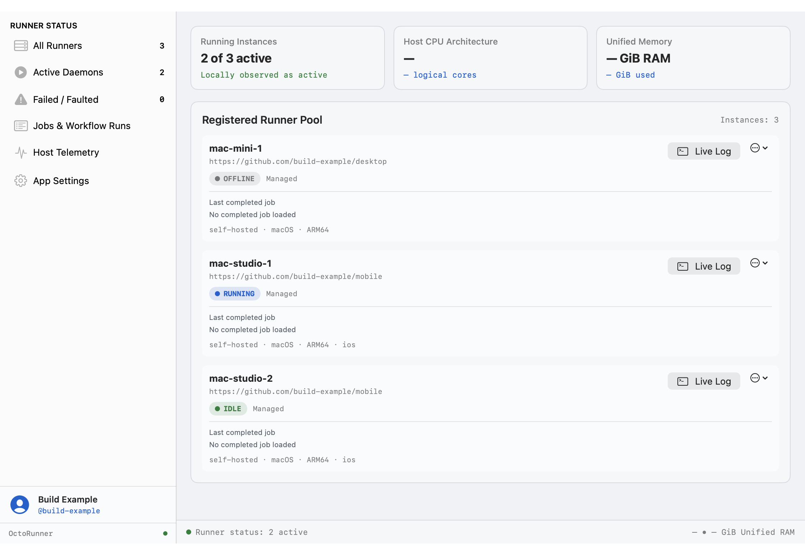
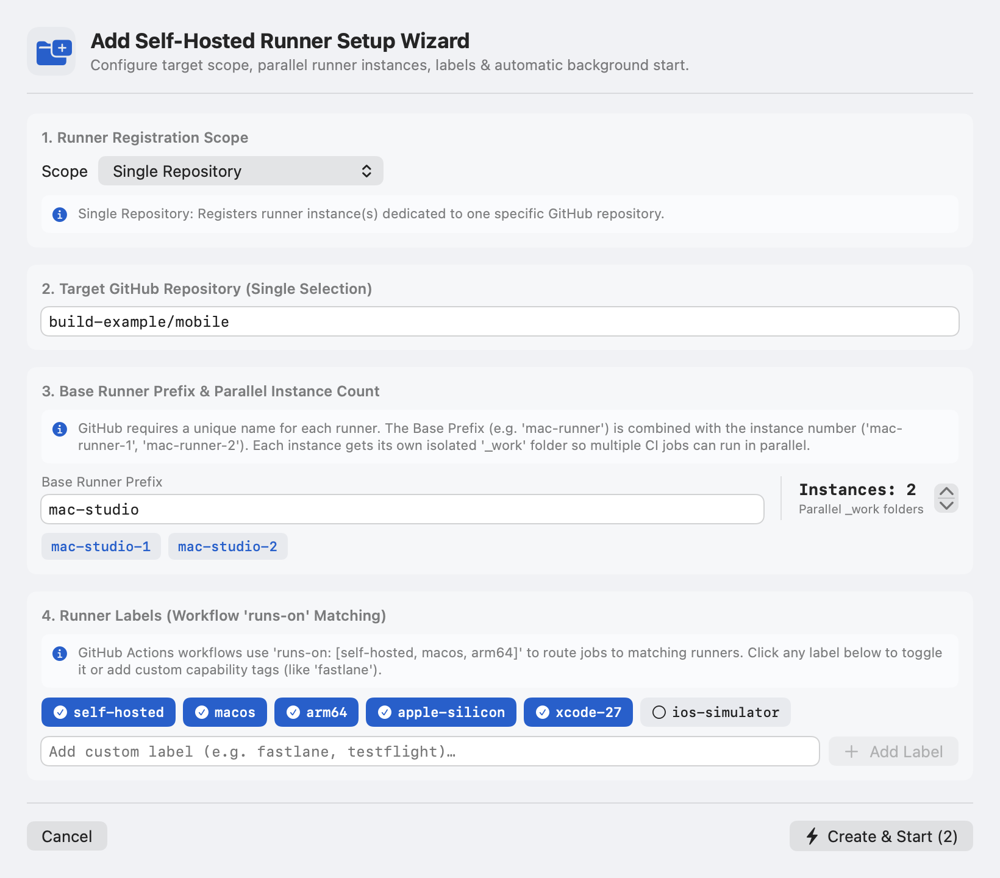
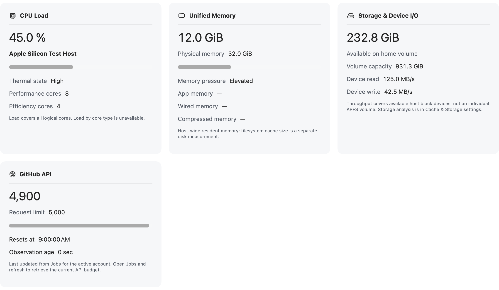

# OctoRunner

OctoRunner is a native macOS app for managing self-hosted GitHub Actions runners on Apple Silicon. Use it to register and import runners, see which workflows they are running, and investigate failures from the dashboard or menu bar.

[Download](https://github.com/loesch-digital/octorunner/releases/latest) · [Documentation](docs/README.md) · [Report an issue](https://github.com/loesch-digital/octorunner/issues) · [Apache 2.0 license](LICENSE)

[](https://github.com/loesch-digital/octorunner/actions/workflows/ci.yml)
[](https://github.com/loesch-digital/octorunner/releases/latest)
[](LICENSE)



## Install

OctoRunner requires **macOS 15 or later** and an **Apple Silicon Mac**.

### Homebrew

```sh
brew install --cask loesch-digital/tap/octorunner
```

If Homebrew asks you to trust the cask:

```sh
brew tap loesch-digital/tap
brew trust --cask loesch-digital/tap/octorunner
brew install --cask loesch-digital/tap/octorunner
```

To upgrade after switching to the shared tap:

```sh
brew update
brew upgrade --cask loesch-digital/tap/octorunner
```

If you installed OctoRunner from `loesch-digital/octorunner`, follow the [one-time tap migration](https://github.com/loesch-digital/homebrew-tap#migrate-from-the-previous-tap).

### Signed download

Download `OctoRunner-<version>-arm64.zip` from the latest GitHub release, extract it, and move **OctoRunner.app** to **Applications**. Open it from Finder. Published Mac builds are signed with Developer ID and notarized by Apple. [Latest release](https://github.com/loesch-digital/octorunner/releases/latest)

To verify a downloaded installation:

```sh
spctl --assess --type execute -vv /Applications/OctoRunner.app
```

## Get started

1. **Connect GitHub.** Sign in with a GitHub device code or a personal access token. To switch accounts, open **Settings → Auth & Tokens** and select a connected account. Tokens are stored in the macOS Keychain.
2. **Add a runner.** Open **New Runner** and choose a repository, an organization, or multiple repositories. The base name prefix names your local runners. Add a shared label such as `mac-build` to route jobs to that pool. Use **Import Folder…** to add a runner from an existing installation.
3. **Route your workflow.** In GitHub Actions, use a label or runner group that matches the intended runners. GitHub assigns the job to an available matching runner. [Using self-hosted runners in a workflow](https://docs.github.com/en/actions/how-tos/manage-runners/self-hosted-runners/use-in-a-workflow)

   ```yaml
   jobs:
     build:
       runs-on: [self-hosted, macOS, ARM64, mac-build]
       steps:
         - run: xcodebuild -version
   ```

4. **Watch a run.** The dashboard shows runner availability separately from the last job result. Open **Jobs & Workflow Runs** to view runs, related pull requests, jobs, steps, and available GitHub logs. For organization runners, add the repositories you want to follow under **History sources**.

### GitHub permissions

Grant access to the repositories and organizations you plan to manage. For a fine-grained token, use **Actions: Read** for run history and job logs, with **Pull requests: Read** if you want related PR lookups. Repository runner management requires **Administration: Write**. For organization runner management, use the organization's **Self-hosted runners: Write** permission. Use the corresponding read permission for runner inventory and status. Organization policies and runner group access still apply. [GitHub runner permissions](https://docs.github.com/en/rest/actions/self-hosted-runners?apiVersion=2026-03-10) · [GitHub workflow run permissions](https://docs.github.com/en/rest/actions/workflow-runs?apiVersion=2026-03-10)

## What you can do

- **Operate runners.** Start, stop, or restart managed runners and follow local log output. Directly managed runners support restart policies, backoff, quarantine, and a local concurrency limit.
- **Keep runners running after you quit.** Installed user LaunchAgents run independently through `launchd`. Directly managed runners depend on the app. Imported external runners stay with their existing process manager until you migrate them.
- **Monitor from the menu bar.** See fleet health while the main window is closed. Enable native macOS notifications for runner availability, local job failures, and low disk space in Settings.
- **Investigate workflow failures.** See job results separately from runner health. Review workflow details and logs from GitHub, inspect local runner diagnostics, or search and export the audit log.
- **Inspect your Mac.** Open **Host Telemetry** for CPU, memory, disk and I/O measurements, runner process details, and the last observed GitHub API rate limit. Review available cleanup actions before applying them to managed runner storage.

## Screenshots

These screens use example data.

| Runner setup | Host telemetry |
| --- | --- |
| [](docs/assets/app-screens/runner-setup.png) | [](docs/assets/app-screens/telemetry.png) |

## Build and run from Xcode

Install the current supported Xcode and [XcodeGen](https://github.com/yonaskolb/XcodeGen#installing). Generate the project and run the OctoRunner scheme on **My Mac** using Xcode. You can run a development build without installing the Homebrew cask.

```sh
swift scripts/generate-app-icons.swift
xcodegen generate
open OctoRunner.xcodeproj
```

The Debug app uses the same local data and Keychain namespace as the release app. Quit the installed app first and use a separate macOS test account when testing with disposable runners. [Development and acceptance](docs/10-development-and-acceptance.md)

```sh
swift test --package-path Packages/OctoRunnerKit --no-parallel
python3 -m unittest discover -s scripts/tests
```

## License

Copyright © 2026 loesch-digital. OctoRunner is licensed under the [Apache License, Version 2.0](LICENSE).
