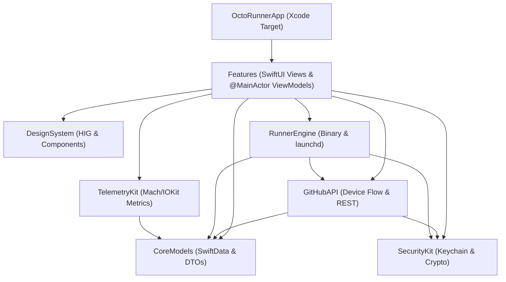

# 01 — System-Architektur, Modularisierung & Standards

## 1. Technische Eckdaten & Standards

| Bereich | Standard / Spezifikation |
| :--- | :--- |
| **App Name & Bundle** | `OctoRunner.app` (Anzeigename: `OctoRunner` / `ActionsRunner for GitHub`) |
| **Bundle Identifier** | `io.octorunner.macos` |
| **Zielplattform** | macOS 15.0+ (Sequoia), Native Apple Silicon (`arm64`) & Universal 2 |
| **Sprache & Compiler** | Swift 6.0+ mit `SWIFT_STRICT_CONCURRENCY = complete` (Zero Data Races) |
| **UI Framework** | SwiftUI 6 (`@Observable`, `NavigationSplitView`, `MenuBarExtra`, `Settings` Scene) |
| **Persistenz** | SwiftData (`@Model`, `@Relationship(deleteRule: .cascade)`, `#Index`, `#Predicate`) |
| **Security & Tokens** | Data Protection Keychain (`SecItem`, `kSecClassGenericPassword`, `SecAccessControl`) gemäß `swift-security-expert` |
| **Prozess-Steuerung** | **Hybrid-Architektur (Evaluierung siehe § 4):** `SMAppService.mainApp` für App-Login-Autostart + Direkte Prozess-Steuerung via **`swift-subprocess` / `Foundation.Process` + Process-Group (`setpgid`) & Non-Blocking Pipe Streaming** als Primärmodus (Echtzeit-Logs ohne Disk-I/O) + optionaler `launchd` User-LaunchAgent (`~/Library/LaunchAgents/io.octorunner.agent.<uuid>.plist`) für Headless-Betrieb nach App-Ende |
| **Sandbox Status** | **Hardened Runtime aktiviert** (`ENABLE_HARDENED_RUNTIME = YES`), **App Sandbox deaktiviert** (`com.apple.security.app-sandbox = false`), damit `xcodebuild`, `fastlane`, `git`, Homebrew und Subprozesse uneingeschränkt laufen können |
| **Lokalisierung** | String Catalog (`Localizable.xcstrings`) für Deutsch (`de`) und Englisch (`en`) |

---

## 2. Modulare Projekt-Struktur (SPM + XcodeGen)

Um maximale Wiederverwendbarkeit, schnelle inkrementelle Builds und isolierte Unit-Tests (`swift test` ohne Xcode-GUI-Zwang) zu erreichen, besteht das Projekt aus einem **dünnen App-Target** (`OctoRunnerApp`) und einem **lokalen Multi-Target Swift Package** (`Packages/OctoRunnerKit`):

```text
octorunner/
├── project.yml                      # XcodeGen Spezifikation (generiert OctoRunner.xcodeproj)
├── package.json                     # release-it Konfiguration & Skripte
├── Gemfile                          # Fastlane & CocoaPods/Bundler Setup
├── fastlane/
│   ├── Fastfile                     # Lanes: match_certs, build_mac, notarize_mac, release_archive
│   ├── Matchfile                    # Anbindung an dein bestehendes Match-Git-Repo (developer_id)
│   └── Appfile                      # Bundle-ID (io.octorunner.macos) & Apple Team ID
├── App/
│   ├── OctoRunnerApp.swift          # @main Entrypoint (WindowGroup, MenuBarExtra, Settings)
│   ├── OctoRunner.entitlements      # Hardened Runtime + Keychain Access Groups
│   └── Resources/
│       ├── Assets.xcassets          # AppIcon (aus Stitch), Farben & Symbol-Assets
│       └── Localizable.xcstrings    # DE / EN String Catalog
└── Packages/
    └── OctoRunnerKit/
        ├── Package.swift            # Swift 6.0 Package Manifest
        ├── Sources/
        │   ├── CoreModels/          # SwiftData @Model Klassen, Enums & Sendable DTOs
        │   ├── DesignSystem/        # macOS HIG Farben, Typografie, Badges, Terminal-Views
        │   ├── SecurityKit/         # KeychainActor, TokenVault, Touch ID / LAContext
        │   ├── GitHubAPI/           # OAuthDeviceFlowActor, GitHubRESTClient, RunnerDownloadService
        │   ├── RunnerEngine/        # RunnerBinaryManager, LaunchAgentSupervisor, LogStreamActor
        │   ├── TelemetryKit/        # HostTelemetryActor (CPU E/P-Cores, RAM, APFS Disk, Thermal)
        │   └── Features/
        │       ├── AuthFeature/     # Screen 1: OAuth Device Flow & PAT Modal
        │       ├── DashboardFeature/# Screen 2, 4, 5: Main Dashboard, Config, Live Logs
        │       ├── WizardFeature/   # Screen 3: Add Runner Setup Wizard
        │       ├── MenuBarFeature/  # Screen 6: macOS Menu Bar Popover
        │       ├── SettingsFeature/ # Screen 7a-7e: Settings Tabs
        │       ├── JobsFeature/     # Screen 8: Workflow Runs & Queue View
        │       └── TelemetryFeature/# Screen 9: Apple Silicon Hardware Monitor
        └── Tests/
            ├── CoreModelsTests/
            ├── SecurityKitTests/
            ├── GitHubAPITests/
            └── RunnerEngineTests/
```

### Modul-Abhängigkeitsgraph



---

## 3. Verbindliche Architektur-Regeln aus den 4 Agent Skills

### 3.1 `swift-concurrency-pro` (Swift 6 Strict Concurrency)
1. **Striktes Actor-Design ohne Reentrancy-Bugs:**
   - Alle Netzwerk-, Keychain-, Prozess- und Dateisystem-Operationen laufen in dedizierten `actor`-Typen (`GitHubOAuthActor`, `KeychainVaultActor`, `RunnerSupervisorActor`, `RunnerBinaryCacheActor`, `HostTelemetryActor`).
   - Vor jedem `await` innerhalb eines Actors wird lokaler State gesichert, nach dem `await` werden Invarianten erneut geprüft (kein blindes Verlassen auf Zustand vor dem `await`).
2. **Kein `@unchecked Sendable`:**
   - Alle DTOs zwischen Actors und `@MainActor`-Views sind reine `struct` oder `enum` mit `Sendable`-Konformität.
3. **Structured Concurrency & Cancellation:**
   - Parallele Runner-Installationen (z.B. 2–4 Instanzen im Setup-Wizard) nutzen `withThrowingTaskGroup`.
   - OAuth-Polling und Live-Log-Streaming (`AsyncStream<LogLine>`) reagieren kooperativ auf `Task.checkCancellation()` bzw. `.task(id:)` in SwiftUI (automatisches Abbrechen beim Schließen des Modals).

### 3.2 `swift-security-expert` (Keychain & Credential Lifecycle)
1. **Kein Secret in `UserDefaults`, `SwiftData` oder `.plist`:**
   - Weder OAuth Access Tokens noch Personal Access Tokens (PATs) noch Runner Registration Tokens dürfen jemals in `SwiftData` oder `UserDefaults` landen.
   - In `SwiftData` (`GitHubAccountEntity`) werden ausschließlich unkritische Metadaten (`username`, `avatarUrl`, `scopes`, `keychainAccountIdentifier`) gespeichert.
2. **Add-or-Update Pattern & `OSStatus` Prüfung:**
   - Jeder `SecItemAdd`-Aufruf behandelt `errSecDuplicateItem` durch ein atomares `SecItemUpdate`. Jeder `OSStatus` wird typisiert ausgewertet.
3. **Access Control & Biometrie (Optional in Settings 7c):**
   - Standardmäßig werden Tokens mit `kSecAttrAccessibleWhenUnlockedThisDeviceOnly` und `kSecUseDataProtectionKeychain: true` gespeichert.
   - Optional kann in den Settings (Tab 7c) Touch ID / `LAContext` für das Einsehen oder Rotieren von Tokens aktiviert werden.

### 3.3 `swiftdata-pro` (Datenmodellierung & Abfragen)
1. **Explizite Delete-Rules & Indizes (macOS 15 / iOS 18+ API):**
   - `@Model final class RunnerEntity` nutzt `#Index<RunnerEntity>([\.statusRaw], [\.name])` für schnelle Filterung in der Sidebar.
   - Beziehungen zwischen `RunnerEntity` und `JobRunEntity` definieren explizit `@Relationship(deleteRule: .cascade, inverse: \JobRunEntity.runner)`.
2. **Sichere `#Predicate`-Abfragen:**
   - Keine Laufzeit-Crashes durch `isEmpty == false` (stattdessen `!$0.labels.isEmpty` oder unterstützte `localizedStandardContains`-Filter).
   - `@Query` wird ausschließlich direkt in SwiftUI Views genutzt; Services/Actors erhalten bei Bedarf eine `ModelConfiguration` bzw. einen eigenen `@ModelActor`.

### 3.4 `swiftui-pro` (Moderne SwiftUI 6 & macOS HIG)
1. **Observation statt `ObservableObject`:**
   - Ausschließliche Nutzung von `@Observable`, `@State`, `@Environment` und `@Bindable` (keine Legacy `@StateObject`, `@ObservedObject` oder `@Published`).
2. **Moderne Modifier & API:**
   - `foregroundStyle()` statt `foregroundColor()`, `clipShape(.rect(cornerRadius:))` statt `cornerRadius()`, `Button("Title", systemImage: "icon", action: ...)` für volle VoiceOver-Accessibility.
   - Keine manuellen `Binding(get:set:)`-Konstrukte in `body`, sondern direkte Bindings mit `.onChange(of:)`.
   - Ein Typ pro Datei (`One Type Per File`), strukturiert nach Feature-Modulen.

---

## 4. Kritische Architektur-Entscheidungen (ADRs — Hinterfragt statt blind übernommen)

In den Stitch-Entwürfen und dem ersten Spec-Draft standen einige Konzepte, die in der Praxis unter macOS 15+ und Swift 6 **nicht funktionieren oder veraltet sind**. Hier ist die kritische Analyse und unsere modernere Lösung:

### ADR-01: Warum `SMAppService.agent(plistName:)` aus dem Spec-Draft für dynamische Runner NICHT funktioniert
- **Was im Draft stand:** `SMAppService.agent(plistName: "io.octorunner.agent.\(id).plist")` für jeden neu angelegten Runner aufrufen.
- **Warum das technisch fehlschlägt:** Apples `SMAppService.agent(plistName:)` sucht die `.plist` zwingend **innerhalb des schreibgeschützten, signierten App-Bundles** (`OctoRunner.app/Contents/Library/LaunchAgents/`). Würde die App zur Laufzeit dort neue `.plist`-Dateien für Runner 1, 2, 3 hineinschreiben, **bricht sofort die Code-Signatur und Notarisierung** von `OctoRunner.app` (`Code Signature Invalid` beim nächsten Start)!
- **Was ist der moderne, saubere Weg (Unsere Lösung)?**
  1. **Für den Autostart von OctoRunner selbst:** Wir nutzen **`SMAppService.mainApp`** (macOS 13+ Standard). Damit startet `OctoRunner` beim macOS-Login automatisch im Hintergrund (als MenuBar-App ohne Dock-Icon, wenn das Fenster zu ist).
  2. **Für die Runner-Prozesse (Dual-Mode Supervisor):**
     - **Modus A — Direct Managed Child Process (Empfohlener Standard):** `OctoRunner` startet und überwacht `run.sh` / `Runner.Listener` direkt über einen Swift 6 Actor (`RunnerProcessActor`) mit eigener Process-Group (`setpgid`).
       - **Vorteile gegenüber `launchd`:**
         - **Echtzeit `stdout`/`stderr` Streaming über Pipes (`AsyncStream`):** Keine Verzögerung und kein SSD-Verschleiß durch Logfile-Polling.
         - **Volle Benutzer-Umgebung:** Automatisches Erben von Keychain-Zugriff (für `fastlane match` in Workflows!), Xcode-Developer-Dir und Homebrew-Pfaden ohne fragiles `.plist`-Gefrickel.
         - **Exaktes Graceful Shutdown & Child-Tracking:** Beim Stoppen oder App-Beenden senden wir gezielt `SIGINT`/`SIGTERM` an den `Runner.Listener` (damit er sich sauber bei GitHub abmeldet) und kennen sofort die exakte `PID`.
     - **Modus B — Standalone `launchd` User LaunchAgent (Optional für Headless-Betrieb auch wenn OctoRunner beendet wird):** Wenn der User in den Settings explizit wünscht, dass Runner weiterlaufen, selbst wenn er `OctoRunner` per `⌘Q` komplett beendet, generiert die App eine saubere `.plist` unter `~/Library/LaunchAgents/io.octorunner.agent.<id>.plist` und lädt sie über das moderne `launchctl bootstrap gui/<uid>`.

### ADR-02: Native macOS Window-Chrome statt HTML-nachgebauter Traffic Lights
- **Was in den Stitch-HTML-Exports steckt:** Eigene gezeichnete rote/gelbe/grüne Fenster-Buttons (`×`, `−`, `+`) und ein künstlicher Header-Balken im Content-Bereich.
- **Warum man das in SwiftUI NICHT nachbaut:** Würde man in einer echten macOS-App eigene Traffic-Lights rendern, hätte man entweder doppelte Fenster-Buttons oder verlöre native macOS-Features (Vollbild-Tile-Menü beim Hover auf Grün, Stage Manager, Mission Control).
- **Unsere Lösung (`swiftui-pro`):** Wir nutzen **echtes macOS Window-Styling** (`.windowStyle(.hiddenTitleBar)`, `.windowToolbarStyle(.unified)` und native `.toolbar`-Items). Dadurch sitzen die echten macOS Traffic-Lights exakt an der Stelle wie im Stitch-Design, inklusive nativem Vibrancy-Effekt (`.ultraThinMaterial`).

### ADR-03: APFS Snapshots & Ephemeral Runners (Saubere Isolation statt Root-Befehlen)
- **Was in Screen 7a stand:** *"APFS Snapshot frequency: After every failed job"*.
- **Kritische Prüfung:** Echte APFS Volume Snapshots (`tmutil localsnapshot` oder `mount_apfs -s`) erfordern unter macOS `root`-Rechte (`sudo`) und gelten immer nur für das **gesamte APFS-Volume** (also die ganze Festplatte des Users), nicht für einen einzelnen `_work`-Ordner!
- **Was ist die viel bessere, moderne APFS-Technik (Unsere Lösung)?**
  1. **APFS Copy-on-Write Directory Clones (`clonefile` / `cp -c`):** Auf Apple Silicon mit APFS kann ein ganzes Runner- oder `_work`-Verzeichnis mittels `FileManager` / `clonefile(2)` in **0 Millisekunden und mit 0 Byte zusätzlichem Speicherplatz** geklont oder gesichert werden — komplett ohne Root-Rechte!
  2. **GitHub Ephemeral Flag (`--ephemeral`) + Pre-Job Cleanup:** Zusätzlich unterstützen wir das offizielle `--ephemeral`-Flag des GitHub Runners bzw. schnelles APFS-Cloning, sodass jeder Job in einer garantiert sauberen Umgebung startet.

### ADR-04: App Icon & Vector Assets (100% Transparenz & automatische Skalierung)
- **Analyse des Stitch-Icons:** Das exportierte `screen.png` aus Stitch hatte einen weißen Hintergrund (`RGB` ohne Alpha-Kanal). Unter macOS wirkt ein Icon mit weißem Kasten im Dock unprofessionell.
- **Unsere Lösung:**
  - Das Master-Icon (`docs/assets/app_icon.png`, `1024×1024`) wurde per CoreGraphics exakt entlang der macOS-HIG-Squircle-Geometrie (`824×824` Body + weicher Drop-Shadow) freigestellt und besitzt nun einen **echten RGBA-Alpha-Kanal (100% transparenter Hintergrund)**.
  - Das Swift-Skript [`scripts/generate-app-icons.swift`](../scripts/generate-app-icons.swift) generiert daraus vollautomatisch alle 10 für Xcode benötigten macOS-Auflösungen (`16x16@1x` bis `512x512@2x`) inkl. `Contents.json`.
  - Für das Menüleisten-Icon liegt unter [`docs/assets/menubar_icon.svg`](./assets/menubar_icon.svg) eine echte **Vektor-SVG** (Template-Image für automatisches Dark/Light-Tinting in der macOS-Menüleiste).

### ADR-05: Warum "Personal Account Level Runners" auf GitHub eine Halluzination sind (und wie wir sie im Wizard abbilden)
- **Was im Stitch-Mockup (Screen 3: Setup Wizard) stand:** Segment 1: `Personal Account` mit Ziel-URL `https://github.com/dein-benutzer`.
- **Kritische Faktenprüfung (Live gegen die GitHub REST API & Docs):**
  - GitHub unterstützt Self-Hosted Runner ausschließlich auf **3 Hierarchie-Ebenen**:
    1. **Repository-Level** (`/repos/{owner}/{repo}/actions/runners`)
    2. **Organization-Level** (`/orgs/{org}/actions/runners` — ein Runner für alle Repos einer Organisation)
    3. **Enterprise-Level** (`/enterprises/{enterprise}/actions/runners`)
  - Auf einem **persönlichen GitHub-Account (User Account)** gibt es unter `github.com/settings` im Menü *Code, planning, and automation* **keinen** Punkt *Actions -> Runners*, und der API-Endpunkt `GET /user/actions/runners` liefert `404 Not Found` (häufige KI-Halluzination, die Organization-Settings mit Personal-Settings verwechselt).
- **Unsere Lösung für OctoRunner (Echter Mehrwert statt Fehler-Dialog):**
  - Wenn der User im Setup-Wizard **`Personal Account`** auswählt, lädt `OctoRunner` über `GET /user/repos?affiliation=owner` alle seine persönlichen Repositories zur einfachen Ein- oder Mehrfachauswahl!
  - Wählt der User dort z.B. 3 seiner privaten Repositories aus, legt `OctoRunner` per **APFS Copy-on-Write (`clonefile`)** ohne doppelten Speicherverbrauch im Hintergrund die benötigten Runner-Instanzen für diese Repos an. So bekommt man auch mit einem persönlichen GitHub-Account das Komfort-Erlebnis eines "Account-weiten Runners"!
  - Alternativ kann man auf GitHub jederzeit eine **kostenlose GitHub Organization** anlegen — dort funktioniert ein einziger Runner nativ für alle Repositories der Organisation.


