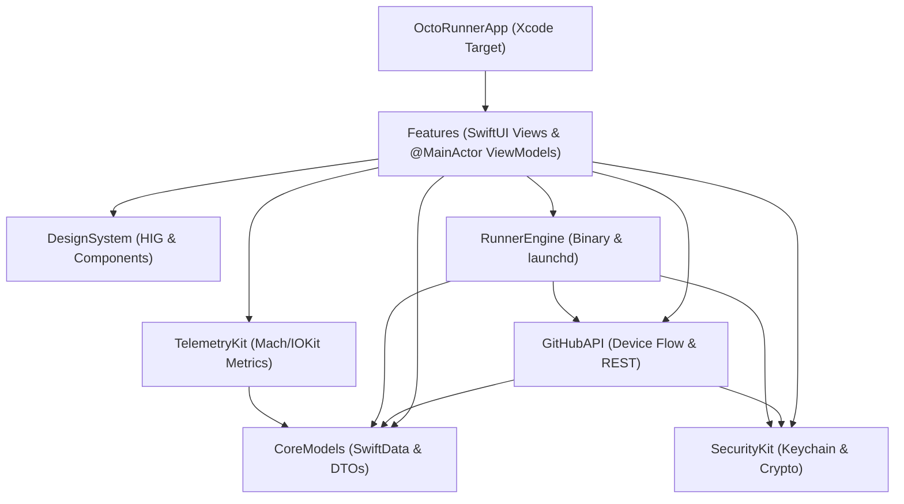

# 01 — System Architecture, Modules, and Standards

## 1. Technical specifications

| Area | Standard or specification |
| :--- | :--- |
| **App name and bundle** | `OctoRunner.app` (display name `OctoRunner` / `ActionsRunner for GitHub`) |
| **Bundle identifier** | `io.octorunner.macos` |
| **Target platform** | macOS 15.0+ (Sequoia), native Apple silicon (`arm64`) and Universal 2 |
| **Language and compiler** | Swift 6.0+ with `SWIFT_STRICT_CONCURRENCY = complete` to prevent data races |
| **UI framework** | SwiftUI 6 (`@Observable`, `NavigationSplitView`, `MenuBarExtra`, `Settings` scene) |
| **Persistence** | SwiftData (`@Model`, `@Relationship(deleteRule: .cascade)`, `#Index`, `#Predicate`) |
| **Security and tokens** | Data Protection Keychain (`SecItem`, `kSecClassGenericPassword`, `SecAccessControl`) following `swift-security-expert` |
| **Process management** | See ADR-01. `SMAppService.mainApp` starts the app at login. Direct supervision uses a dedicated process group created by `posix_spawn`. Standalone runner LaunchAgents in `~/Library/LaunchAgents` can run after the app quits. An opt-in bundled LaunchAgent can observe registered local processes after the GUI quits. Pipe streaming is planned separately. |
| **Sandbox and runtime** | Hardened Runtime is enabled (`ENABLE_HARDENED_RUNTIME = YES`). App Sandbox is disabled (`com.apple.security.app-sandbox = false`) so `xcodebuild`, `fastlane`, `git`, Homebrew, and subprocesses can run without sandbox restrictions. |
| **Localization** | String catalog (`Localizable.xcstrings`) for German (`de`) and English (`en`) |

---

## 2. Project structure (SPM and XcodeGen)

The project uses a **thin app target** (`OctoRunnerApp`) and a **local multi-target Swift package** (`Packages/OctoRunnerKit`). This supports code reuse, fast incremental builds, and isolated unit tests through `swift test` without the Xcode GUI.

```text
octorunner/
├── project.yml                      # XcodeGen specification (generates OctoRunner.xcodeproj)
├── package.json                     # release-it configuration and scripts
├── Gemfile                          # Fastlane and CocoaPods/Bundler setup
├── fastlane/
│   ├── Fastfile                     # Lanes: match_certs, build_mac, notarize_mac, release_archive
│   ├── Matchfile                    # Integration with the existing Match Git repository (developer_id)
│   └── Appfile                      # Bundle ID (io.octorunner.macos) and Apple Team ID
├── App/
│   ├── OctoRunnerApp.swift          # @main entry point (WindowGroup, MenuBarExtra, Settings)
│   ├── OctoRunner.entitlements      # Hardened Runtime and Keychain access groups
│   └── Resources/
│       ├── Assets.xcassets          # AppIcon (from Stitch), colors, and symbol assets
│       └── Localizable.xcstrings    # German and English string catalog
└── Packages/
    └── OctoRunnerKit/
        ├── Package.swift            # Swift 6.0 package manifest
        ├── Sources/
        │   ├── CoreModels/          # SwiftData @Model classes, enums, and Sendable DTOs
        │   ├── DesignSystem/        # macOS HIG colors, typography, badges, and terminal views
        │   ├── SecurityKit/         # KeychainActor, TokenVault, Touch ID / LAContext
        │   ├── GitHubAPI/           # OAuthDeviceFlowActor, GitHubRESTClient, RunnerDownloadService
        │   ├── RunnerEngine/        # RunnerBinaryCacheActor, LaunchAgentPlistGenerator, RunnerProvisionerActor
        │   ├── SyncKit/             # LocalRunnerDiscoveryActor, GitHubRunnerSyncActor, SyncModels
        │   ├── TelemetryKit/        # HostTelemetryActor (CPU E/P cores, RAM, APFS disk, thermal state)
        │   └── Features/
        │       ├── AuthFeature/     # Screen 1: OAuth Device Flow and PAT sheet
        │       ├── DashboardFeature/# Screens 2, 4, 5: Main dashboard, configuration, live logs
        │       ├── WizardFeature/   # Screen 3: Add Runner Setup Wizard
        │       ├── MenuBarFeature/  # Screen 6: macOS menu bar popover
        │       ├── SettingsFeature/ # Screens 7a–7e: Settings tabs
        │       ├── JobsFeature/     # Screen 8: Workflow runs and queue view
        │       └── TelemetryFeature/# Screen 9: Apple silicon hardware monitor
        └── Tests/
            ├── CoreModelsTests/
            ├── SecurityKitTests/
            ├── GitHubAPITests/
            └── RunnerEngineTests/
```

### Module dependency graph



---

## 3. Architecture requirements from the four agent skills

### 3.1 `swift-concurrency-pro` (Swift 6 strict concurrency)

1. **Actor isolation and reentrancy**
   - Dedicated actors handle all network, Keychain, process, and file system operations. These include `GitHubOAuthActor`, `KeychainVaultActor`, `RunnerSupervisorActor`, `RunnerBinaryCacheActor`, and `HostTelemetryActor`.
   - Capture the relevant state before each `await` in an actor and recheck invariants after suspension.
2. **`Sendable` DTOs**
   - Use `struct` or `enum` types with checked `Sendable` conformance for all DTOs passed between actors and `@MainActor` views.
3. **Structured concurrency and cancellation**
   - Parallel runner installations, such as creating two to four instances in the setup wizard, use `withThrowingTaskGroup`.
   - OAuth polling and live log streaming (`AsyncStream<LogLine>`) cooperate with cancellation through `Task.checkCancellation()` and SwiftUI’s `.task(id:)`, as applicable. Closing the sheet cancels its task.

### 3.2 `swift-security-expert` (Keychain and credential lifecycle)

1. **Credential storage**
   - Keep OAuth access tokens, personal access tokens (PATs), and runner registration tokens out of `UserDefaults`, SwiftData, and plist files.
   - Store only non-sensitive metadata in SwiftData (`GitHubAccountEntity`), including `username`, `avatarUrl`, `scopes`, and `keychainAccountIdentifier`.
2. **Add or update and check `OSStatus`**
   - Handle `errSecDuplicateItem` from each `SecItemAdd` call with an atomic `SecItemUpdate`. Interpret every `OSStatus` as a typed result.
3. **Access control and biometrics (optional in Settings 7c)**
   - Store tokens with `kSecAttrAccessibleWhenUnlockedThisDeviceOnly` and `kSecUseDataProtectionKeychain: true` by default.
   - Settings tab 7c can require Touch ID through `LAContext` to inspect or rotate tokens.

### 3.3 `swiftdata-pro` (data modeling and queries)

1. **Explicit delete rules and indexes (macOS 15 / iOS 18+ APIs)**
   - `@Model final class RunnerEntity` uses `#Index<RunnerEntity>([\.statusRaw], [\.name])` for quick sidebar filtering.
   - The relationship between `RunnerEntity` and `JobRunEntity` explicitly declares `@Relationship(deleteRule: .cascade, inverse: \JobRunEntity.runner)`.
2. **Safe `#Predicate` queries**
   - Use `!$0.labels.isEmpty` or a supported `localizedStandardContains` filter to avoid the runtime crashes associated with `isEmpty == false`.
   - Use `@Query` directly in SwiftUI views. Services and actors receive a `ModelConfiguration` or use a dedicated `@ModelActor` when needed.

### 3.4 `swiftui-pro` (SwiftUI 6 and macOS HIG)

1. **Observation**
   - Use `@Observable`, `@State`, `@Environment`, and `@Bindable` for all state and observation.
2. **Modifiers and APIs**
   - Use `foregroundStyle()`, `clipShape(.rect(cornerRadius:))`, and `Button("Title", systemImage: "icon", action: ...)`. The button initializer supports VoiceOver.
   - Use direct bindings with `.onChange(of:)` to keep custom `Binding(get:set:)` construction out of `body`.
   - Keep one type per file and group files by feature module.

---

## 4. Architecture decision records (ADRs)

These decisions document changes to the Stitch mockups and initial specification for macOS 15+ and Swift 6.

### ADR-01 — App login items and dynamic runner supervision

The draft proposed calling `SMAppService.agent(plistName: "io.octorunner.agent.\(id).plist")` for every new runner. The API requires the plist inside the read-only signed app bundle, at `OctoRunner.app/Contents/Library/LaunchAgents/`. Writing new runner plists there at runtime would invalidate the code signature and notarization and cause a `Code Signature Invalid` error on the next launch.

1. **App login item**

   `SMAppService.mainApp`, available since macOS 13, starts OctoRunner at login as a background menu bar app. The Dock icon can be hidden when the window is closed.
2. **Runner process modes**
   - **Directly managed child process (recommended default).** `RunnerSupervisorActor` starts `run.sh` in a dedicated process group that `posix_spawn` creates atomically. A stop requires the matching launch generation and a fresh observation that the runner is idle. An expired wait leaves the process unsignaled. The GitHub scheduler can assign a new job between the idle check and the signal.
     - A separate connection to `stdout` and `stderr` through pipes is planned for real-time logs. The started process inherits the app’s environment. Keychain access, Xcode selection, and paths configured in Terminal depend on the launch context.
   - **Standalone `launchd` user LaunchAgent (optional).** If the user explicitly chooses to keep runners active after quitting OctoRunner with **⌘Q**, the app writes `~/Library/LaunchAgents/io.octorunner.agent.<id>.plist` and loads it with `launchctl bootstrap gui/<uid>`.

| State | Process ownership and control |
| --- | --- |
| Direct, current launch generation | OctoRunner starts and observes the process group. Stop and restart use the corresponding handle. |
| Verified user LaunchAgent | `launchd` starts the runner and keeps it running after the app quits. Control uses the verified service and its associated plist. |
| Imported or unconfirmed mode | OctoRunner observes the runner. Control requires explicit adoption beyond a saved PID field or generated service label. |

Failover for directly managed runners applies while the app runs. It ties restarts and stops to a specific process generation. A start deferred by Low Power Mode stays pending until Low Power Mode ends or the user cancels it. Quarantine limits restart attempts per app session. Installed LaunchAgents follow their own `launchd` policies.

The supervisor reserves one slot for each directly managed launch generation. Ready starts receive available slots in queue order. A limit change affects future reservations. Failed starts and process exits release their reservations. GitHub assigns workflow jobs. External runners and LaunchAgents manage their processes independently.

### ADR-02 — Native macOS window chrome

The Stitch HTML export drew its own red, yellow, and green window controls (`×`, `−`, `+`) and a header inside the content area. Recreating those controls in SwiftUI would either duplicate them or lose macOS features such as the full-screen tiling menu shown when hovering over the green button, Stage Manager, and Mission Control.

The app uses native window styling through `.windowStyle(.hiddenTitleBar)`, `.windowToolbarStyle(.unified)`, and native `.toolbar` items, following `swiftui-pro`. The native controls match their placement in the Stitch design and retain system vibrancy (`.ultraThinMaterial`).

### ADR-03 — APFS cloning and ephemeral runners

Screen 7a proposed *APFS Snapshot frequency: After every failed job*. On macOS, APFS volume snapshots through `tmutil localsnapshot` or `mount_apfs -s` require root privileges (`sudo`) and apply at the volume level. Runner workspaces need directory-level isolation around `_work`.

1. **APFS copy-on-write clones (`clonefile` / `cp -c`).** On Apple silicon with APFS, use `FileManager` or `clonefile(2)` to clone or back up a runner or `_work` directory. The design calls for an immediate copy with zero additional file data at creation and no root privileges.
2. **GitHub’s `--ephemeral` flag and pre-job cleanup.** The design supports the official GitHub runner flag and fast APFS cloning so each job starts in a clean environment.

### ADR-04 — Transparent app icon and vector menu bar asset

The Stitch `screen.png` export had a white background because the RGB image lacked an alpha channel. The master icon at `docs/assets/app_icon.png` is `1024×1024` and uses CoreGraphics to follow the macOS HIG squircle geometry with an `824×824` body and a soft drop shadow. It has an RGBA alpha channel with a fully transparent background.

The Swift script generates all 10 macOS icon sizes Xcode requires, from `16x16@1x` through `512x512@2x`, along with `Contents.json`. [Icon generation script](../scripts/generate-app-icons.swift).

The menu bar icon uses a vector SVG template image for automatic light and dark appearance tinting. [Menu bar icon](./assets/menubar_icon.svg).

### ADR-05 — Runner scopes for personal GitHub accounts

Screen 3 in the Stitch mockup used a **Personal Account** segment with a URL like `https://github.com/your-user`. The GitHub REST API supports self-hosted runners at three levels.

1. **Repository** (`/repos/{owner}/{repo}/actions/runners`)
2. **Organization** (`/orgs/{org}/actions/runners`), where a runner can serve repositories across the organization
3. **Enterprise** (`/enterprises/{enterprise}/actions/runners`)

A personal account’s **Code, planning, and automation** settings omit **Actions → Runners**, and `GET /user/actions/runners` returns `404 Not Found`.

When the user selects **Personal Account** in the setup wizard, OctoRunner lists personally owned repositories through `GET /user/repos?affiliation=owner` and supports selecting one or more. For example, selecting three private repositories creates the needed runner instance for each repository in the background using APFS copy-on-write cloning (`clonefile`) to avoid duplicating file data. A free GitHub organization also supports a single organization runner that can serve the organization’s repositories.
