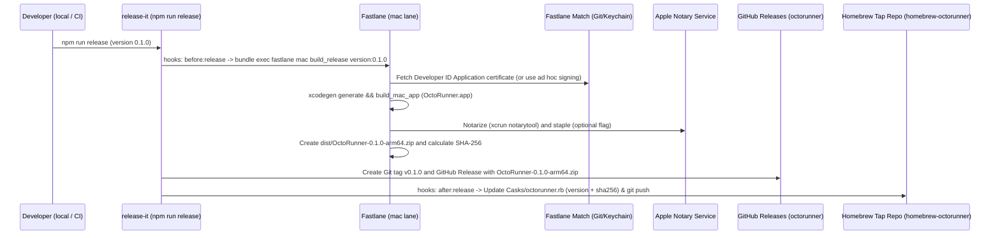

# 03 — Step 1: Infrastructure, Fastlane, `release-it`, and Homebrew Cask (`v0.1.0`)

Step 1 (`v0.1.0`) sets up an automated build, signing, release, and installation workflow. The `OctoRunner.app` build contains the basic app window, the Stitch app icon, and a `MenuBarExtra`. Fastlane uses the existing `match` setup to build and sign the app. `release-it` publishes `v0.1.0` on GitHub, and `brew install --cask <user>/octorunner/octorunner` installs it.

---

## 1. Deployment pipeline



---

## 2. Setup checklist

### 2.1 GitHub repository visibility and self-hosted runners

The initial setup reviewed `@loesch-digital` and its local runner at `/Users/frank/Documents/apps/actions-runner`.

1. **Register a runner for OctoRunner.**
   - The existing `macbook-pro-frank` runner is registered exclusively to `https://github.com/loesch-digital/itemflux-ios-app`, as recorded in `/Users/frank/Documents/apps/actions-runner/.runner`.
   - GitHub registers runners at the repository level for personal accounts such as `@loesch-digital`. An organization can use a runner across its repositories.
   - Step 1 adds a second runner for `loesch-digital/octorunner`, such as `macbook-pro-octorunner`. It reuses the previously downloaded binary in `/Users/frank/Documents/apps/actions-runner` with APFS copy-on-write cloning (`cp -cR`). The OctoRunner UI adds support for managing multiple repository runners on the same Mac in `v0.3.0`.
2. **Choose repository visibility.**
   - **Option A — Make both `loesch-digital/octorunner` and `loesch-digital/homebrew-octorunner` public.** This is the simplest Homebrew setup. `brew install --cask loesch-digital/octorunner/octorunner` can download `OctoRunner-0.1.0-arm64.zip` from GitHub Releases without authentication. This milestone also planned to use the free, unlimited standard GitHub-hosted `macos-15` M-series runners for the public repository when the local runner was unavailable.
   - **Option B — Keep `octorunner` private and make only `homebrew-octorunner` public.** Configure `release-it` to upload compiled ZIPs such as `OctoRunner-0.1.0-arm64.zip` to a GitHub release in the public `loesch-digital/homebrew-octorunner` tap. The source stays private and Homebrew can download the cask without a token.
3. **Set up GitHub Actions.**
   - The initial CI plan uses `.github/workflows/ci.yml` to run `swift test` and check the Xcode build for feature branch (`feat/*`) pushes and pull requests. It targets the local runner using `runs-on: [self-hosted, macos, arm64]`.

### 2.2 Apple Developer account and Fastlane `match`

- **Developer ID for distribution outside the App Store.** The Homebrew cask uses a `developer_id` certificate (`Developer ID Application: Your Name (TEAM_ID)`).
- **Provisioning profiles and Hardened Runtime.** An app without capabilities such as CloudKit and push notifications can sign and notarize using the **Developer ID Application** certificate in the Keychain and Hardened Runtime without a provisioning profile.
- **Reuse the existing Match repository.**
  - Set the existing `git_url` and `team_id` in `fastlane/Matchfile`.
  - If the repository already contains a `developer_id` certificate, run `fastlane match developer_id --readonly` to download it.
  - If the repository contains only iOS certificates (`appstore` or `development`), run `fastlane match developer_id` once to create the macOS certificate in the same repository.
  - The Fastfile’s local testing option, `skip_notarization:true`, lets you build and test release `0.1.0` without waiting for Apple’s notarization service.

---

## 3. Project configuration files

### 3.1 `project.yml` (XcodeGen)

XcodeGen generates `OctoRunner.xcodeproj` deterministically from these settings.

- The **OctoRunner** target uses `platform: macOS` and `deploymentTarget: "15.0"`.
- The following build settings apply.
  - `PRODUCT_BUNDLE_IDENTIFIER: io.octorunner.macos`
  - `SWIFT_VERSION: "6.0"`
  - `SWIFT_STRICT_CONCURRENCY: complete`
  - `ENABLE_HARDENED_RUNTIME: YES`
  - `CODE_SIGN_ENTITLEMENTS: App/OctoRunner.entitlements`
- The local package dependency is `Packages/OctoRunnerKit`.

### 3.2 `App/OctoRunner.entitlements`

The app runs `launchctl`, `git`, `xcodebuild`, and runner subprocesses such as `run.sh` and `Runner.Listener`. The configuration disables App Sandbox for those operations and enables Hardened Runtime for notarization.

```xml
<?xml version="1.0" encoding="UTF-8"?>
<!DOCTYPE plist PUBLIC "-//Apple//DTD PLIST 1.0//EN" "http://www.apple.com/DTDs/PropertyList-1.0.dtd">
<plist version="1.0">
<dict>
    <key>com.apple.security.app-sandbox</key>
    <false/>
    <key>com.apple.security.network.client</key>
    <true/>
    <key>com.apple.security.cs.allow-unsigned-executable-memory</key>
    <true/>
    <key>keychain-access-groups</key>
    <array>
        <string>$(AppIdentifierPrefix)io.octorunner.shared</string>
    </array>
</dict>
</plist>
```

### 3.3 `fastlane/Fastfile`

The macOS lanes build, sign, notarize, and package the app as a ZIP.

```ruby
default_platform(:mac)

platform :mac do
  desc "Synchronize Developer ID certificates via existing Match repository"
  lane :sync_certificates do
    match(
      type: "developer_id",
      platform: "macos",
      readonly: is_ci
    )
  end

  desc "Build, sign, optionally notarize, and package OctoRunner.app for release-it"
  lane :build_release do |options|
    version = options[:version] || "0.1.0"
    skip_notarize = options[:skip_notarize] || false

    sh("cd .. && xcodegen generate")

    # Set marketing version
    increment_version_number_in_xcodeproj(
      version_number: version,
      xcodeproj: "OctoRunner.xcodeproj"
    )

    build_mac_app(
      project: "OctoRunner.xcodeproj",
      scheme: "OctoRunner",
      configuration: "Release",
      output_directory: "dist",
      output_name: "OctoRunner.app",
      export_method: "developer-id",
      xcargs: "ARCHS=arm64 ONLY_ACTIVE_ARCH=NO"
    )

    unless skip_notarize
      notarize(
        package: "dist/OctoRunner.app",
        bundle_id: "io.octorunner.macos",
        print_log: true
      )
    end

    # Create release ZIP preserving symlinks & resource forks using ditto
    zip_path = "dist/OctoRunner-#{version}-arm64.zip"
    sh("cd ../dist && ditto -c -k --sequesterRsrc --keepParent OctoRunner.app OctoRunner-#{version}-arm64.zip")
  end
end
```

### 3.4 `.release-it.json` and `scripts/update-homebrew-cask.sh`

The release configuration manages version numbers such as `0.1.0` and `0.2.0`, generates the changelog, calls Fastlane, uploads GitHub release assets, and updates the Homebrew cask.

```json
{
  "git": {
    "commitMessage": "chore(release): v${version}",
    "tagName": "v${version}",
    "requireCleanWorkingDir": true
  },
  "github": {
    "release": true,
    "releaseName": "OctoRunner v${version}",
    "assets": ["dist/OctoRunner-${version}-arm64.zip"]
  },
  "npm": {
    "publish": false
  },
  "hooks": {
    "before:git:release": [
      "swift test --package-path Packages/OctoRunnerKit",
      "bundle exec fastlane mac build_release version:${version}"
    ],
    "after:release": [
      "./scripts/update-homebrew-cask.sh ${version}"
    ]
  }
}
```

### 3.5 Homebrew cask template (`Casks/octorunner.rb` in the tap repository)

```ruby
cask "octorunner" do
  version "0.1.0"
  sha256 "AUTOMATICALLY_UPDATED_BY_RELEASE_IT"

  url "https://github.com/<GITHUB_OWNER>/octorunner/releases/download/v#{version}/OctoRunner-#{version}-arm64.zip"
  name "OctoRunner"
  desc "Native macOS desktop manager for self-hosted GitHub Actions runners"
  homepage "https://github.com/<GITHUB_OWNER>/octorunner"

  depends_on macos: ">= :sequoia"
  depends_on arch: :arm64

  app "OctoRunner.app"

  zap trash: [
    "~/Library/Application Support/OctoRunner",
    "~/Library/Caches/io.octorunner.macos",
    "~/Library/Logs/OctoRunner",
    "~/Library/Preferences/io.octorunner.macos.plist",
  ]
end
```

---

## 4. What to test in `v0.1.0`

1. **App icon and branding.** `Assets.xcassets` includes the metallic infinity gear icon from the Stitch design at every macOS resolution from `16x16` through `1024x1024`.
2. **Design system in `OctoRunnerKit`.** The module uses the colors, fonts, window chrome, and status badges from `02-design-system-and-hig.md`.
3. **Main window and menu bar item.** The app opens a macOS three-column `NavigationSplitView` with a footer showing `daemon: ready | Apple Silicon native` and a `MenuBarExtra` icon.
4. **Homebrew installation and updates.**

   ```bash
   brew tap <your-user>/octorunner
   brew install --cask octorunner
   open -a OctoRunner
   ```
