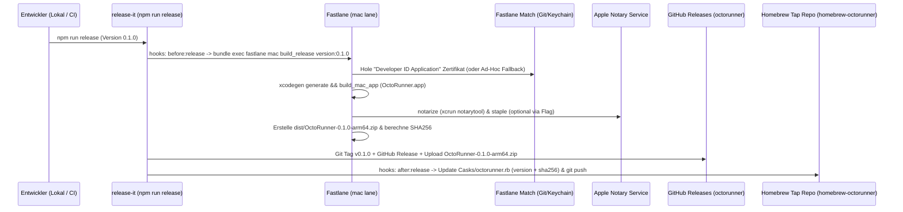

# 03 — Step 1: Infrastruktur, Fastlane, `release-it` & Homebrew Cask (`v0.1.0`)

**Ziel von Step 1 (`v0.1.0`):**  
Ein von Tag 1 an automatisierter Build-, Signier-, Release- und Installations-Workflow. Am Ende von Step 1 kompiliert `OctoRunner.app` (mit dem Basis-App-Shell-Fenster, dem neuen App-Icon aus Stitch und `MenuBarExtra`), wird über **Fastlane** (mit deinem bestehenden `match`-Setup) gebaut & signiert, über **`release-it`** als Version `v0.1.0` auf GitHub veröffentlicht und lässt sich direkt per **`brew install --cask <user>/octorunner/octorunner`** installieren und starten.

---

## 1. Übersicht der Deployment-Pipeline



---

## 2. Was wo konfiguriert werden muss (Checkliste für dich & uns)

### 2.1 Auf GitHub (Einmaliges Setup)
1. **Haupt-Repository (`octorunner`):**
   - Unser aktuelles Repository (`/Users/frank/Documents/apps/octorunner`), gepusht auf GitHub (z.B. `https://github.com/<dein-user>/octorunner`).
2. **Homebrew Tap Repository (`homebrew-octorunner` oder `homebrew-tap`):**
   - Ein zweites, öffentliches GitHub-Repository mit dem Namen **`homebrew-octorunner`** (oder falls du schon ein zentrales `homebrew-tap` hast, nutzen wir das!).
   - *Hinweis:* Durch das Präfix `homebrew-` erlaubt Homebrew die Kurzform `brew tap <dein-user>/octorunner` und `brew install --cask <dein-user>/octorunner/octorunner`.
   - Wir können dieses Repo in Step 1 direkt per `gh repo create homebrew-octorunner --public` für dich anlegen!
3. **GitHub Token für `release-it`:**
   - Lokal: `GITHUB_TOKEN` (oder automatisch über deine eingeloggte `gh auth token` Session) zum Anlegen des GitHub Releases und Pushen der Cask-Formula ins Tap-Repo.

### 2.2 Im Apple Developer Account / Fastlane `match`
Da du **`fastlane match`** bereits in einer anderen App im Einsatz hast:
- **Wichtig für macOS außerhalb des App Stores:** Für Homebrew Casks wird der Zertifikatstyp **`developer_id`** (`Developer ID Application: Dein Name (TEAM_ID)`) benötigt (nicht `appstore` oder `development`).
- **Kein Provisioning Profile zwingend nötig:** Eine macOS App ohne CloudKit/Push-Notifications braucht für die Developer-ID-Signierung + Notarisierung nicht zwingend ein Provisioning Profile, sondern nur das `Developer ID Application` Zertifikat im Keychain + `Hardened Runtime`.
- **So binden wir dein bestehendes Match-Repo ein:**
  - In `fastlane/Matchfile` tragen wir deine bestehende `git_url` und `team_id` ein.
  - Falls in deinem Match-Repo bereits ein `developer_id`-Zertifikat liegt: `fastlane match developer_id --readonly` lädt es sofort herunter.
  - Falls dort bisher nur iOS (`appstore`/`development`) liegt: Einmalig `fastlane match developer_id` ausführen, und Fastlane legt das macOS-Zertifikat im selben Match-Repo an.
  - **Flexibler Dev-Fallback für sofortiges Testen:** Unser `Fastfile` unterstützt zusätzlich einen Parameter `skip_notarization:true`, sodass du jederzeit auch ohne Wartezeit auf den Apple Notary Server in 15 Sekunden ein lokales Release `0.1.0` bauen und testen kannst!

---

## 3. Konfigurationsdateien im Projekt (`octorunner`)

### 3.1 `project.yml` (XcodeGen)
Generiert deterministisch `OctoRunner.xcodeproj` ohne Merge-Konflikte:
- **Target:** `OctoRunner` (`platform: macOS`, `deploymentTarget: "15.0"`)
- **Settings:**
  - `PRODUCT_BUNDLE_IDENTIFIER: io.octorunner.macos`
  - `SWIFT_VERSION: "6.0"`
  - `SWIFT_STRICT_CONCURRENCY: complete`
  - `ENABLE_HARDENED_RUNTIME: YES`
  - `CODE_SIGN_ENTITLEMENTS: App/OctoRunner.entitlements`
- **Local Package Dependency:** `Packages/OctoRunnerKit`

### 3.2 `App/OctoRunner.entitlements`
Da die App `launchctl`, `git`, `xcodebuild` und Subprozesse (`run.sh` / `Runner.Listener`) steuert, ist die App **nicht** in der restriktiven App-Store-Sandbox eingesperrt, nutzt aber **Hardened Runtime** für die Apple-Notarisierung:

```xml
<?xml version="1.0" encoding="UTF-8"?>
<!DOCTYPE plist PUBLIC "-//Apple//DTD PLIST 1.0//EN" "http://www.apple.com/DTDs/PropertyList-1.0.dtd">
<plist version="1.0">
<dict>
    <key>com.apple.security.app-sandbox</key>
    <false/>
    <key>com.apple.security.network.client</key>
    <true/>
    <key>com.apple.security.cs.allow-unsigned-executable-memory</key>
    <true/>
    <key>keychain-access-groups</key>
    <array>
        <string>$(AppIdentifierPrefix)io.octorunner.shared</string>
    </array>
</dict>
</plist>
```

### 3.3 `fastlane/Fastfile`
Definiert die macOS-Lanes für Build, Signierung, Notarisierung und ZIP-Packaging:

```ruby
default_platform(:mac)

platform :mac do
  desc "Synchronize Developer ID certificates via existing Match repository"
  lane :sync_certificates do
    match(
      type: "developer_id",
      platform: "macos",
      readonly: is_ci
    )
  end

  desc "Build, sign, optionally notarize, and package OctoRunner.app for release-it"
  lane :build_release do |options|
    version = options[:version] || "0.1.0"
    skip_notarize = options[:skip_notarize] || false

    sh("cd .. && xcodegen generate")

    # Set marketing version
    increment_version_number_in_xcodeproj(
      version_number: version,
      xcodeproj: "OctoRunner.xcodeproj"
    )

    build_mac_app(
      project: "OctoRunner.xcodeproj",
      scheme: "OctoRunner",
      configuration: "Release",
      output_directory: "dist",
      output_name: "OctoRunner.app",
      export_method: "developer-id",
      xcargs: "ARCHS=arm64 ONLY_ACTIVE_ARCH=NO"
    )

    unless skip_notarize
      notarize(
        package: "dist/OctoRunner.app",
        bundle_id: "io.octorunner.macos",
        print_log: true
      )
    end

    # Create release ZIP preserving symlinks & resource forks using ditto
    zip_path = "dist/OctoRunner-#{version}-arm64.zip"
    sh("cd ../dist && ditto -c -k --sequesterRsrc --keepParent OctoRunner.app OctoRunner-#{version}-arm64.zip")
  end
end
```

### 3.4 `.release-it.json` & `scripts/update-homebrew-cask.sh`
Steuert Versionierung (`0.1.0`, `0.2.0`...), Changelog-Generierung, den Fastlane-Aufruf, den GitHub-Release-Asset-Upload und das Update des Homebrew Casks:

```json
{
  "git": {
    "commitMessage": "chore(release): v${version}",
    "tagName": "v${version}",
    "requireCleanWorkingDir": true
  },
  "github": {
    "release": true,
    "releaseName": "OctoRunner v${version}",
    "assets": ["dist/OctoRunner-${version}-arm64.zip"]
  },
  "npm": {
    "publish": false
  },
  "hooks": {
    "before:git:release": [
      "swift test --package-path Packages/OctoRunnerKit",
      "bundle exec fastlane mac build_release version:${version}"
    ],
    "after:release": [
      "./scripts/update-homebrew-cask.sh ${version}"
    ]
  }
}
```

### 3.5 Homebrew Cask Template (`Casks/octorunner.rb` im Tap-Repo)
```ruby
cask "octorunner" do
  version "0.1.0"
  sha256 "AUTOMATICALLY_UPDATED_BY_RELEASE_IT"

  url "https://github.com/<GITHUB_OWNER>/octorunner/releases/download/v#{version}/OctoRunner-#{version}-arm64.zip"
  name "OctoRunner"
  desc "Native macOS desktop manager for self-hosted GitHub Actions runners"
  homepage "https://github.com/<GITHUB_OWNER>/octorunner"

  depends_on macos: ">= :sequoia"
  depends_on arch: :arm64

  app "OctoRunner.app"

  zap trash: [
    "~/Library/Application Support/OctoRunner",
    "~/Library/Caches/io.octorunner.macos",
    "~/Library/Logs/OctoRunner",
    "~/Library/Preferences/io.octorunner.macos.plist",
  ]
end
```

---

## 4. Umfang der ausführbaren Version `v0.1.0` (Was du nach Step 1 testen kannst)

Nach Abschluss von Step 1 hast du bereits eine echte, installierbare macOS-App (`v0.1.0`):
1. **App-Icon & Branding:** Das metallische Infinity-Gear Icon aus deinem Stitch-Design ist in allen macOS-Auflösungen (`16x16` bis `1024x1024`) im `Assets.xcassets` hinterlegt.
2. **DesignSystem Modul (`OctoRunnerKit`):** Farben, Fonts, Window-Chrome und Status-Pills aus `02-design-system-and-hig.md`.
3. **Hauptfenster & MenuBar-Item Shell:** Startet mit dem macOS 3-Spalten-Rahmen (`NavigationSplitView`), dem Status-Footer (`daemon: ready | Apple Silicon native`) und dem `MenuBarExtra`-Icon in der oberen macOS-Menüleiste.
4. **Installation & Update per Homebrew:**
   ```bash
   brew tap <dein-user>/octorunner
   brew install --cask octorunner
   open -a OctoRunner
   ```
