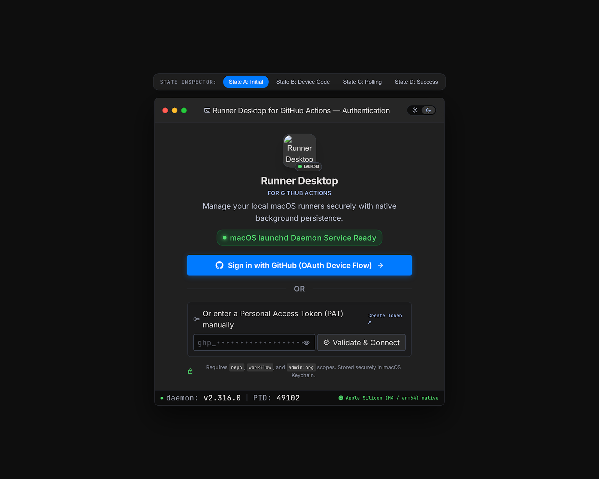

# 04 — Step 2: GitHub Authentication (OAuth Device Flow & PAT) + Keychain (`v0.2.0`)

Step 2 (`v0.2.0`) implements **Dialog 1 (`1._authentication_oauth_device_flow_modal_3_states`)** with GitHub OAuth Device Flow (`RFC 8628`), a personal access token (PAT) fallback, scope validation (`repo`, `workflow`, `admin:org`), and secure storage in the macOS Data Protection Keychain. The implementation follows `swift-security-expert` and `swift-concurrency-pro`.



---

## 1. One-time GitHub setup

Authentication works like the official GitHub CLI (`gh auth login`). The device flow uses a public client ID and requires neither a backend server nor an organization-level app installation.

Register a **GitHub OAuth App** once so GitHub displays the **OctoRunner** name and app icon in the browser during the device flow.

1. Go to **[github.com/settings/developers](https://github.com/settings/developers)**, choose **OAuth Apps**, then select **New OAuth App**.
2. Fill in the three required fields.
   - **Application name** — `OctoRunner Desktop`
   - **Homepage URL** — `https://github.com/<your-user>/octorunner`
   - **Authorization callback URL** — `http://127.0.0.1/callback` (the form requires a URL and the device flow leaves it unused).
3. Select **Enable Device Flow**.
4. Click **Register application**. Optionally, upload the app icon at `docs/assets/app_icon.png`.
5. Copy the displayed **Client ID**, which starts with `Ov23li...`. The device flow only needs this public ID.

> [!TIP]
> OctoRunner ships with a default client ID. Developers and self-hosters can enter their own client ID or GitHub Enterprise Server URL in **Auth & Tokens** settings.

---

## 2. GitHub OAuth Device Flow sequence

```mermaid
sequenceDiagram
    participant UI as OAuthDeviceFlowSheet (@MainActor)
    participant Actor as GitHubOAuthActor (GitHubAPI)
    participant GH as github.com / api.github.com
    participant KC as KeychainVaultActor (SecurityKit)

    UI->>Actor: requestDeviceCode(clientId, scopes: ["repo", "workflow", "admin:org"])
    Actor->>GH: POST https://github.com/login/device/code (Accept: application/json)
    GH-->>Actor: { device_code, user_code: "WDX8-8222", verification_uri, expires_in: 900, interval: 5 }
    Actor-->>UI: State B: Show code "WDX8-8222", countdown, and copy button
    UI->>UI: User clicks "Open GitHub Verification Page" (NSWorkspace.shared.open)
    UI->>Actor: pollForAccessToken(deviceCode, interval: 5)
    loop Every 5 seconds (or interval + 5s on slow_down) until Task.isCancelled
        Actor->>GH: POST https://github.com/login/oauth/access_token
        alt authorization_pending
            GH-->>Actor: { error: "authorization_pending" }
        else slow_down
            GH-->>Actor: { error: "slow_down", interval: 10 }
            Actor->>Actor: Increase polling interval to 10s
        else access_token received
            GH-->>Actor: { access_token: "gho_...", token_type: "bearer", scope: "admin:org,repo,workflow" }
        end
    end
    Actor->>GH: GET https://api.github.com/user (validate user and X-OAuth-Scopes header)
    GH-->>Actor: UserProfile (@login, id, avatar_url) + Scopes
    Actor->>KC: saveToken(token, accountId: user.login)
    KC-->>Actor: Saved in macOS Keychain
    Actor-->>UI: State D: Connected Successfully (@login)
```

---

## 3. Four UI states from the Stitch design (`OAuthDeviceFlowSheet.swift`)

The sheet implements all four states from `1._authentication_oauth_device_flow_modal_3_states/code.html`.

### State A — Initial (`AuthFlowState.initial`)

- The header shows the app icon with a `launchd` badge, the title *Runner Desktop for GitHub Actions*, and a green *macOS launchd Daemon Service Ready* status badge.
- The primary action is the blue system button **Sign in with GitHub (OAuth Device Flow) →**.
- The secondary action provides a **Personal Access Token (PAT)** field for `ghp_...` or `github_pat_...`, a show/hide toggle (`visibility`), a link to `https://github.com/settings/tokens`, and a **Validate & Connect** button.
- The scope hint lists `repo`, `workflow`, and `admin:org`.

### State B — Device code (`AuthFlowState.codeGenerated(DeviceCodeResponse)`)

- A card displays the code in large monospaced type, such as `WDX8-8222`. Its copy button uses `NSPasteboard.general` and shows a green *✓ Copied to clipboard!* confirmation.
- A live countdown such as `Code expires in 14:48` uses `TimelineView` and `Task.sleep`.
- **Open GitHub Verification Page** optionally copies the code, opens `https://github.com/login/device` in the default browser, and immediately moves to state C.
- **Cancel** ends the flow and returns to state A.

### State C — Waiting for authorization (`AuthFlowState.polling(DeviceCodeResponse)`)

- A native, pulsing radar spinner uses `phaseAnimator` and `symbolEffect(.rotate)`.
- A status badge displays `Checking github.com/login/device every 5s...`.
- A three-step indicator shows `1. Code Generated` in green, `2. Browser Pending` in pulsing blue, and `3. Daemon Binding`.
- Closing the sheet or selecting **Cancel Authorization** immediately cancels the polling task through Swift structured concurrency (`task(id:)`), following `swift-concurrency-pro`.

### State D — Success (`AuthFlowState.authenticated(GitHubAccountDTO)`)

- A green check badge displays *Connected Successfully! Authorized as @username*.
- A confirmation card displays *macOS Keychain Updated — Access token bound securely*.
- **Open Runner Pool Dashboard →** closes the sheet and loads the linked organizations and repositories in the main window.

---

## 4. Keychain security (`SecurityKit`)

The module at `Packages/OctoRunnerKit/Sources/SecurityKit` follows `swift-security-expert`.

1. **Data Protection Keychain attributes**
   - `kSecClass` uses `kSecClassGenericPassword`.
   - `kSecAttrService` uses `"io.octorunner.macos.github-oauth"` or `.github-pat`.
   - `kSecAttrAccount` uses the GitHub user ID or login.
   - `kSecAttrAccessible` uses `kSecAttrAccessibleWhenUnlockedThisDeviceOnly`, which prevents tokens from leaving this Mac through iCloud Backup.
2. **Add or update**

   Call `SecItemAdd` first. On `errSecDuplicateItem`, immediately call `SecItemUpdate` to preserve the stored item while updating it.
3. **Token validation and scope checks**

   After either PAT sign-in or the device flow, `GitHubRESTClient` calls `GET https://api.github.com/user`. It inspects the `X-OAuth-Scopes` HTTP response header or checks Administration access for fine-grained PATs to verify that the account can request runner registration tokens.

---

## 5. What to test in `v0.2.0`

1. Launch `OctoRunner.app`.
2. The **Authentication** dialog opens when the Keychain has no token or when you click the account button at the top right.
3. Sign in through GitHub OAuth Device Flow with a one-time browser code, or use a PAT.
4. Verify that the app loads your username, avatar, and verified scopes and that the Keychain retains the token across app restarts.
5. Publish **`v0.2.0`** to the Homebrew cask with `npm run release`.
