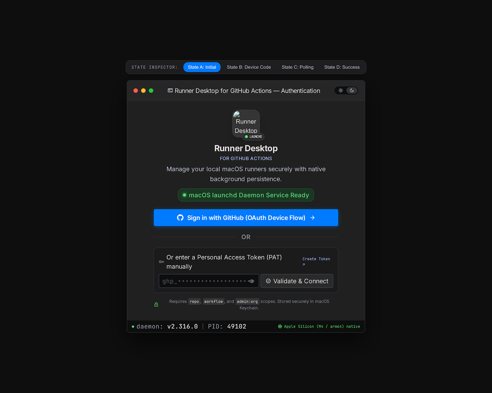

# 04 — Step 2: GitHub Authentication (OAuth Device Flow & PAT) + Keychain (`v0.2.0`)

**Ziel von Step 2 (`v0.2.0`):**  
Vollständige Implementierung von **Dialog 1 (`1._authentication_oauth_device_flow_modal_3_states`)** inkl. GitHub OAuth Device Flow (`RFC 8628`), Personal Access Token (PAT) Fallback, Scope-Validierung (`repo`, `workflow`, `admin:org`) und hochsicherer Ablage im macOS Data Protection Keychain gemäß `swift-security-expert` und `swift-concurrency-pro`.



---

## 1. Was einmalig auf GitHub gemacht werden muss (In 60 Sekunden erledigt, Zero Secrets!)

Wie von dir gewünscht: **Es gibt kein Client Secret**, keinen Backend-Server und **niemand muss bei der Installation eine App in seiner Organisation installieren** — es funktioniert exakt wie bei der offiziellen GitHub CLI (`gh auth login`).

Damit GitHub beim Device Flow den Namen **"OctoRunner"** und unser App-Icon im Browser anzeigt, legst du einmalig eine **GitHub OAuth App** an:

1. Öffne **[github.com/settings/developers](https://github.com/settings/developers)** → Tab **"OAuth Apps"** → **"New OAuth App"**.
2. Fülle die 3 Pflichtfelder aus:
   - **Application name:** `OctoRunner Desktop`
   - **Homepage URL:** `https://github.com/<dein-user>/octorunner`
   - **Authorization callback URL:** `http://127.0.0.1/callback` *(Wird beim Device Flow technisch gar nicht aufgerufen, ist im Formular nur ein Pflichtfeld).*
3. Setze den Haken bei: ✅ **"Enable Device Flow"**.
4. Klicke auf **"Register application"** (optional kannst du dort direkt unser App-Icon `docs/assets/app_icon.png` hochladen).
5. Kopiere die angezeigte **`Client ID`** (beginnt mit `Ov23li...`).
   - *Wichtig:* Klicke **nicht** auf "Generate a new client secret". Der Device Flow braucht **nur** die öffentliche `Client ID`.

> [!TIP]
> **Für Entwickler & Self-Hoster:** Wir hinterlegen deine `Client ID` als Standard in `OctoRunner`, erlauben aber zusätzlich in den Settings (`Auth & Tokens`), bei Bedarf eine eigene `Client ID` oder GitHub Enterprise Server URL einzutragen.

---

## 2. Technischer Ablauf des GitHub OAuth Device Flows

```mermaid
sequenceDiagram
    participant UI as OAuthDeviceFlowSheet (@MainActor)
    participant Actor as GitHubOAuthActor (GitHubAPI)
    participant GH as github.com / api.github.com
    participant KC as KeychainVaultActor (SecurityKit)

    UI->>Actor: requestDeviceCode(clientId, scopes: ["repo", "workflow", "admin:org"])
    Actor->>GH: POST https://github.com/login/device/code (Accept: application/json)
    GH-->>Actor: { device_code, user_code: "WDX8-8222", verification_uri, expires_in: 900, interval: 5 }
    Actor-->>UI: State B: Zeige Code "WDX8-8222" + Countdown + Copy-Button
    UI->>UI: User klickt "Open GitHub Verification Page" (NSWorkspace.shared.open)
    UI->>Actor: pollForAccessToken(deviceCode, interval: 5)
    loop Alle 5 Sekunden (oder interval + 5s bei slow_down) bis Task.isCancelled
        Actor->>GH: POST https://github.com/login/oauth/access_token
        alt authorization_pending
            GH-->>Actor: { error: "authorization_pending" }
        else slow_down
            GH-->>Actor: { error: "slow_down", interval: 10 }
            Actor->>Actor: Erhöhe Polling-Intervall auf 10s
        else access_token erhalten
            GH-->>Actor: { access_token: "gho_...", token_type: "bearer", scope: "admin:org,repo,workflow" }
        end
    end
    Actor->>GH: GET https://api.github.com/user (Prüfe User & X-OAuth-Scopes Header)
    GH-->>Actor: UserProfile (@login, id, avatar_url) + Scopes
    Actor->>KC: saveToken(token, accountId: user.login)
    KC-->>Actor: Gespeichert in macOS Keychain
    Actor-->>UI: State D: Connected Successfully (@login)
```

---

## 3. Die 4 UI-States aus dem Stitch-Design (`OAuthDeviceFlowSheet.swift`)

Das Modal implementiert exakt die 4 Zustände aus `1._authentication_oauth_device_flow_modal_3_states/code.html`:

### State A: Initial (`AuthFlowState.initial`)
- **Header:** App-Icon mit `launchd` Badge, Titel *"Runner Desktop for GitHub Actions"*, grüne Status-Pill *"macOS launchd Daemon Service Ready"*.
- **Primär-Aktion:** Blauer System-Button **"Sign in with GitHub (OAuth Device Flow) →"**.
- **Sekundär-Aktion (OR):** Eingabefeld für **Personal Access Token (PAT)** (`ghp_...` / `github_pat_...`) mit Show/Hide-Toggle (`visibility`), Link zu `https://github.com/settings/tokens` und Button **"Validate & Connect"**.
- **Scope-Hinweis:** Zeigt die benötigten Scopes `repo`, `workflow`, `admin:org` an.

### State B: Device Code Anzeige (`AuthFlowState.codeGenerated(DeviceCodeResponse)`)
- **Prominente Code-Karte:** Großer Monospace-Code (z.B. `WDX8-8222`) mit One-Click-Copy-Button (`NSPasteboard.general`) und grünem *"✓ Copied to clipboard!"*-Feedback.
- **Ablauf-Timer:** Live-Countdown (z.B. `Code expires in 14:48`), gesteuert über `TimelineView` / `Task.sleep`.
- **Aktionen:**
  - **"Open GitHub Verification Page"** → Kopiert optional den Code automatisch in die Zwischenablage, öffnet `https://github.com/login/device` im Standardbrowser und wechselt sofort in **State C (Polling)**.
  - **"Cancel"** → Bricht den Flow ab und kehrt zu State A zurück.

### State C: Waiting / Polling (`AuthFlowState.polling(DeviceCodeResponse)`)
- **Apple-Native Radar-Animation:** Pulsierender Radar-Spinner (`phaseAnimator` / `symbolEffect(.rotate)`).
- **Status-Pille:** `Checking github.com/login/device every 5s...`
- **3-Stufen-Fortschrittsanzeige:** `1. Code Generated` (Grün) → `2. Browser Pending` (Blau pulsierend) → `3. Daemon Binding`.
- **Kooperative Cancellation (`swift-concurrency-pro`):** Schließt der User das Sheet oder klickt auf *"Cancel Authorization"*, wird der Polling-Task sofort über Swift Structured Concurrency (`task(id:)`) abgebrochen.

### State D: Success (`AuthFlowState.authenticated(GitHubAccountDTO)`)
- **Grünes Check-Badge:** *"Connected Successfully! Authorized as @username"*.
- **Keychain-Bestätigungskarte:** *"macOS Keychain Updated — Access token bound securely"*.
- **Button:** *"Open Runner Pool Dashboard →"* schließt das Sheet und lädt die verknüpften Organisationen und Repositories im Hauptfenster.

---

## 4. Security-Implementierung nach `swift-security-expert` (`SecurityKit`)

Im Modul `Packages/OctoRunnerKit/Sources/SecurityKit` setzen wir alle Vorgaben des `swift-security-expert` Skills um:

1. **Data Protection Keychain & Item-Attribute:**
   - `kSecClass`: `kSecClassGenericPassword`
   - `kSecAttrService`: `"io.octorunner.macos.github-oauth"` (bzw. `.github-pat`)
   - `kSecAttrAccount`: GitHub User-ID / Login-Name
   - `kSecAttrAccessible`: `kSecAttrAccessibleWhenUnlockedThisDeviceOnly` (Token verlässt niemals diesen Mac via iCloud Backup).
2. **Add-or-Update Pattern:**
   - Versuch via `SecItemAdd`. Bei `errSecDuplicateItem` sofortiges `SecItemUpdate` ohne Datenverlust.
3. **Token-Validierung & Scope-Check:**
   - Beim PAT-Login wie auch nach dem Device Flow ruft `GitHubRESTClient` `GET https://api.github.com/user` auf und liest den HTTP-Response-Header `X-OAuth-Scopes` (bzw. prüft bei Fine-Grained PATs die Administration-Rechte), um sicherzustellen, dass Runner-Registration-Tokens angefordert werden können.

---

## 5. Umfang der ausführbaren Version `v0.2.0` (Was du nach Step 2 testen kannst)

1. App starten (`OctoRunner.app`).
2. Wenn noch kein Token im Keychain liegt (oder über den Account-Button oben rechts), öffnet sich der **Authentication Dialog**.
3. Du kannst dich **echt per GitHub OAuth Device Flow** (mit Einmal-Code im Browser) **oder per PAT** einloggen.
4. Dein Account (`@username`, Avatar, verifizierte Scopes) wird geladen, das Token liegt geschützt im macOS Keychain und bleibt über App-Neustarts hinweg erhalten.
5. Veröffentlichung via `npm run release` als **`v0.2.0`** ins Homebrew Cask.
