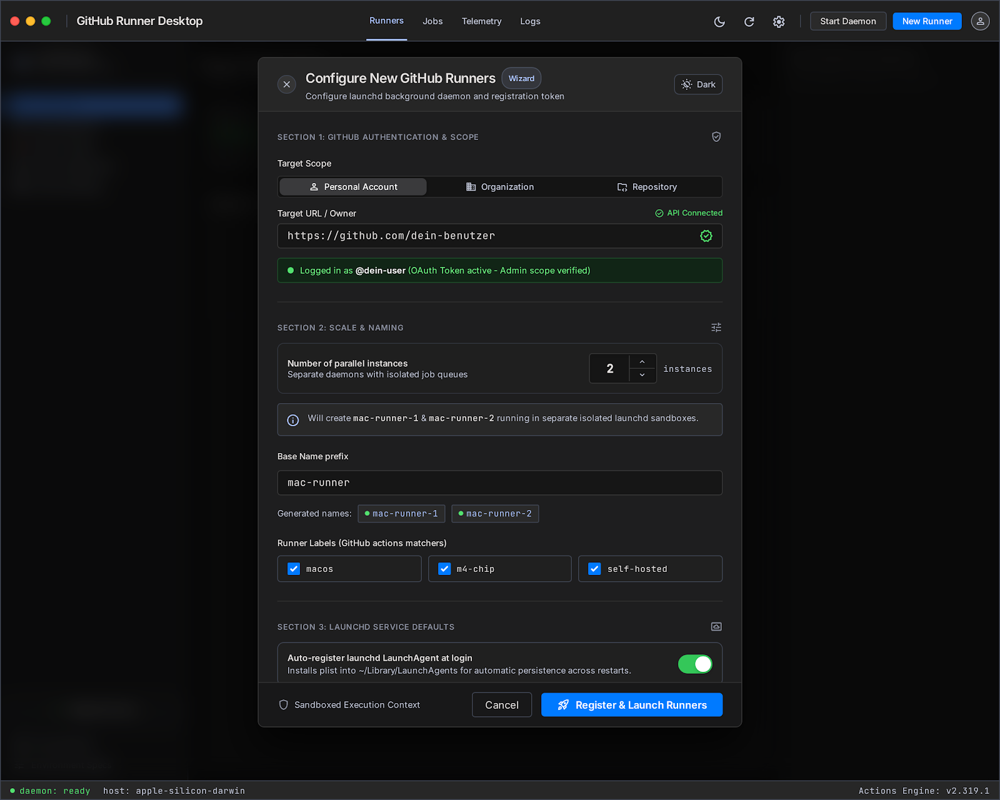
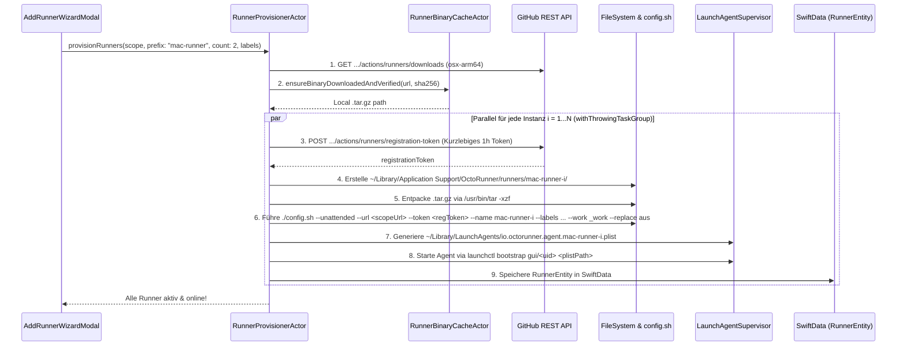

# 05 — Step 3: Add Runner Setup Wizard, Binary Auto-Download & `launchd` Engine (`v0.3.0`)

**Ziel von Step 3 (`v0.3.0`):**  
Implementierung von **Dialog 3 (`3._add_runner_setup_wizard`)** sowie der kompletten **`RunnerEngine`**: Automatisches Ermitteln, Herunterladen, SHA256-Verifizieren und Cachen der offiziellen GitHub Actions Runner Binary (`osx-arm64`), automatisches Anfordern des kurzlebigen Registration-Tokens via GitHub API, paralleles Einrichten von $1 \dots N$ Runner-Instanzen (`config.sh --unattended`) und Registrierung als native macOS User `LaunchAgents` (`~/Library/LaunchAgents/io.octorunner.agent.<id>.plist`).

---

## 1. Wie die GitHub Runner Binary-Download-URL ermittelt & gecacht wird

Du hattest im Prompt erwähnt: *"dann muss die download url von github runner hinterlegt werden"*. So lösen wir das sauber, standardkonform und schnell:

1. **Offizielle GitHub REST API Abfrage (Dynamisch & immer aktuell):**
   - Je nach gewähltem Scope ruft `GitHubRESTClient` den offiziellen Endpunkt auf:
     - **Repository Scope:** `GET /repos/{owner}/{repo}/actions/runners/downloads`
     - **Organization Scope:** `GET /orgs/{org}/actions/runners/downloads`
   - Die API liefert eine JSON-Liste aller offiziellen Runner-Pakete inkl. `os`, `architecture`, `download_url`, `filename` und `sha256_checksum`.
   - Wir filtern automatisch nach `os == "osx"` und `architecture == "arm64"` (bzw. `x64` auf Intel-Macs via `uname -m`).
2. **Konfigurierbarer Fallback / Custom Override URL:**
   - In `AppPreferencesStore` (und in den Settings) ist zusätzlich die offizielle GitHub Releases Fallback-URL hinterlegt (`https://github.com/actions/runner/releases/latest`), bzw. kann eine eigene Mirror-/Enterprise-Download-URL eingetragen werden.
3. **Lokaler Binary-Cache mit SHA256-Prüfung (`RunnerBinaryCacheActor`):**
   - Das heruntergeladene Archiv (z.B. `actions-runner-osx-arm64-2.320.0.tar.gz`, ca. 180 MB) wird unter `~/Library/Caches/io.octorunner.macos/binaries/` abgelegt.
   - Vor dem Entpacken prüft `CryptoKit.SHA256.hash(data:)` die Prüfsumme gegen den `sha256_checksum`-Wert von GitHub (`swift-security-expert`).
   - Wenn der User im Wizard **2 oder 4 parallele Runner** anlegt, wird das `.tar.gz` **nur ein einziges Mal** heruntergeladen und danach blitzschnell aus dem lokalen Cache in die jeweiligen Runner-Verzeichnisse entpackt!

---

## 2. Aufbau von Dialog 3: Add Runner Setup Wizard (`AddRunnerWizardModal.swift`)

Das Sheet folgt exakt dem Stitch-Design `3._add_runner_setup_wizard`:

### Section 1: GitHub Authentication & Scope
- **Target Scope Segmented Control:**
  - `Personal Account` (Wählt ein Repository des eigenen Accounts über ein durchsuchbares Dropdown/Auto-Complete)
  - `Organization` (Listet die Organisationen des eingeloggten Users via `GET /user/orgs`)
  - `Repository` (Direkte Auswahl oder Eingabe von `https://github.com/owner/repo` mit Live-Verifikationshaken `API Connected`)
- **Authenticated Status Badge:**
  - Grünes Banner: `Logged in as @username (OAuth Token active - Admin scope verified)`.

### Section 2: Scale & Naming
- **Number of parallel instances (Stepper `1` bis `8`):**
  - Erlaubt das gleichzeitige Anlegen mehrerer isolierter Runner-Daemons (z.B. `2 instances`).
- **Dynamischer Info-Banner:**
  - Zeigt live an: `Will create mac-runner-1 & mac-runner-2 running in separate isolated launchd sandboxes.`
- **Base Name Prefix Input & Preview Chips:**
  - Eingabefeld (Standard: `mac-runner`) generiert darunter live die grünen Preview-Pills (`• mac-runner-1`, `• mac-runner-2`).
- **Runner Labels (GitHub Actions Matchers):**
  - Vorbelegte Checkbox-Chips (`macos`, `m4-chip` / `apple-silicon`, `self-hosted`) + Möglichkeit, eigene Labels (wie `ios-build`, `xcode-16`, `fastlane`) direkt hinzuzufügen.

### Section 3: `launchd` Service Defaults
- **Toggle:** `Auto-register launchd LaunchAgent at login` (Standard: Aktiv).
- **Plist Target Readout:** Zeigt den transparenten Pfad `~/Library/LaunchAgents/io.octorunner.agent.<runner-name>.plist` mit Status `Ready`.
- **Footer Button:** **`🚀 Register & Launch Runners`** mit mehrstufiger Fortschrittsanzeige während der Provisionierung.

---

## 3. Technischer Provisionierungs-Flow (`RunnerProvisionerActor`)

Wenn der User auf **"Register & Launch Runners"** klickt, läuft folgender hochparalleler Workflow (`withThrowingTaskGroup` gemäß `swift-concurrency-pro`) ab:

### Warum `~/Library/LaunchAgents/` + `launchctl bootstrap gui/<uid>`?
- **Kein Root-Zwang & voller Xcode/Keychain-Zugriff:** Für iOS/macOS CI-Builds (`xcodebuild`, `fastlane`, iOS Simulator `simctl`, User-Keychain) **muss** ein GitHub Actions Runner in der `gui/<uid>` Domain des eingeloggten macOS-Users laufen.
- **Saubere `EnvironmentVariables` in der `.plist`:** Wir injizieren automatisch `/opt/homebrew/bin:/usr/local/bin:/usr/bin:/bin:/usr/sbin:/sbin` sowie `LANG=en_US.UTF-8` in die generierte LaunchAgent-Plist, damit Homebrew-Tools (`fastlane`, `xcodes`, `swiftlint`, `node`) in jedem GitHub Actions Workflow sofort gefunden werden!

---

## 4. Umfang der ausführbaren Version `v0.3.0` (Was du nach Step 3 testen kannst)

1. Im Hauptfenster auf **"+ New Runner"** bzw. **"Register Runner"** klicken.
2. Im **Setup Wizard** dein GitHub-Repo oder deine Organisation auswählen, Anzahl (z.B. `2`) und Name (`mac-runner`) wählen.
3. Auf **"Register & Launch Runners"** klicken:
   - `OctoRunner` lädt das offizielle Runner-Paket herunter, verifiziert den SHA256-Hash, holt die Registration-Tokens von GitHub, konfiguriert die Runner headless und startet die `launchd`-Dienste.
4. Wenn du auf GitHub in dein Repo unter `Settings -> Actions -> Runners` schaust, stehen `mac-runner-1` und `mac-runner-2` dort sofort auf **🟢 Idle (Online)** und nehmen echte GitHub Actions Workflows entgegen!
5. Veröffentlichung via `npm run release` als **`v0.3.0`** ins Homebrew Cask.
