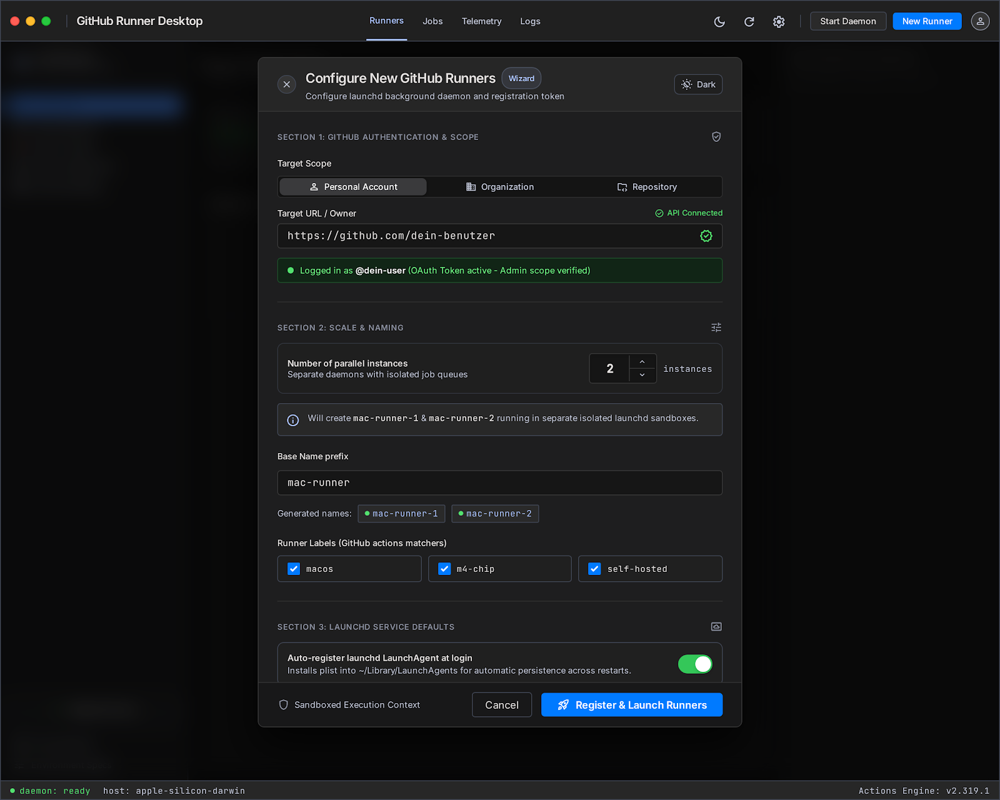
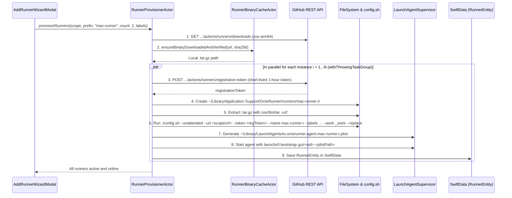

# 05 — Step 3: Add Runner Setup Wizard, Binary Auto-Download & `launchd` Engine (`v0.3.0`)

Step 3 (`v0.3.0`) implements **Dialog 3 (`3._add_runner_setup_wizard`)** and the full **`RunnerEngine`**. The engine finds, downloads, verifies with SHA-256, and caches the official GitHub Actions runner binary (`osx-arm64`). It requests short-lived registration tokens from the GitHub API, sets up $1 \dots N$ runner instances in parallel with `config.sh --unattended`, and registers them as native macOS user LaunchAgents under `~/Library/LaunchAgents/io.octorunner.agent.<id>.plist`.

---

## 1. Finding and caching GitHub Actions runner downloads

1. **GitHub REST API**

   `GitHubRESTClient` calls the endpoint for the selected scope.
   - Repository scope uses `GET /repos/{owner}/{repo}/actions/runners/downloads`.
   - Organization scope uses `GET /orgs/{org}/actions/runners/downloads`.
   - The response lists official runner packages with `os`, `architecture`, `download_url`, `filename`, and `sha256_checksum`.
   - The client filters for `os == "osx"` and `architecture == "arm64"`, or `x64` on Intel Macs based on `uname -m`.
2. **Fallback and custom URLs**

   `AppPreferencesStore` and Settings provide the official GitHub Releases fallback URL (`https://github.com/actions/runner/releases/latest`) and accept a custom mirror or enterprise download URL.
3. **Local cache with SHA-256 verification (`RunnerBinaryCacheActor`)**
   - The engine stores the archive under `~/Library/Caches/io.octorunner.macos/binaries/`. One example is `actions-runner-osx-arm64-2.320.0.tar.gz`, approximately 180 MB.
   - Before extraction, `CryptoKit.SHA256.hash(data:)` checks the archive against GitHub’s `sha256_checksum`, following `swift-security-expert`.
   - When you create multiple runners at once, the engine downloads the archive once and extracts it from the local cache into each runner directory.

---

## 2. Dialog 3 — Add Runner Setup Wizard (`AddRunnerWizardModal.swift`)

The sheet follows the Stitch design `3._add_runner_setup_wizard`.

### Section 1 — GitHub authentication and scope

- The target scope segmented control offers three choices.
  - **Personal Account** lets you find a repository on your account using a searchable dropdown with autocomplete.
  - **Organization** lists the organizations for your GitHub account using `GET /user/orgs`.
  - **Repository** lets you select or enter a URL such as `https://github.com/owner/repo` and shows an **API Connected** checkmark after verification.
- A green badge displays `Logged in as @username (OAuth Token active - Admin scope verified)`.

### Section 2 — Scale and naming

- A stepper from `1` through `8` lets you create isolated runner daemons at the same time.
- A live banner shows the expected result, such as `Will create mac-runner-1 & mac-runner-2 running in separate isolated launchd sandboxes.`
- The base name field defaults to `mac-runner` and updates the green name previews below it as you type.
- Select preset GitHub Actions runner labels such as `macos`, `m4-chip` or `apple-silicon`, and `self-hosted`, or add custom labels such as `ios-build`, `xcode-16`, and `fastlane`.

### Section 3 — `launchd` service defaults

- **Auto-register launchd LaunchAgent at login** is enabled by default.
- The wizard displays the target plist path, `~/Library/LaunchAgents/io.octorunner.agent.<runner-name>.plist`, with a **Ready** status.
- **🚀 Register & Launch Runners** starts provisioning and displays progress through each stage.

---

## 3. Provisioning sequence (`RunnerProvisionerActor`)

Selecting **Register & Launch Runners** runs the following steps in parallel with `withThrowingTaskGroup`, following `swift-concurrency-pro`.

### Why use `~/Library/LaunchAgents/` and `launchctl bootstrap gui/<uid>`?

- For iOS and macOS CI builds using `xcodebuild`, `fastlane`, `simctl`, and the user Keychain, the GitHub Actions runner needs the logged-in user’s `gui/<uid>` domain. That domain gives it access to Xcode and the user Keychain without root privileges.
- The generated LaunchAgent plist sets `EnvironmentVariables` with `/opt/homebrew/bin:/usr/local/bin:/usr/bin:/bin:/usr/sbin:/sbin` in the path and `LANG=en_US.UTF-8`. GitHub Actions workflows can then find Homebrew tools such as `fastlane`, `xcodes`, `swiftlint`, and `node`.

---

## 4. What to test in `v0.3.0`

1. In the main window, click **+ New Runner** or **Register Runner**.
2. In the **Setup Wizard**, select your GitHub repository or organization, enter the number of instances, such as `2`, and enter a base name, such as `mac-runner`.
3. Click **Register & Launch Runners**. OctoRunner downloads the official package, verifies its SHA-256 hash, requests registration tokens, configures the runners without user interaction, and starts the `launchd` services.
4. In your GitHub repository, open **Settings → Actions → Runners**. Verify that `mac-runner-1` and `mac-runner-2` show **🟢 Idle (Online)** and accept GitHub Actions jobs.
5. Publish **`v0.3.0`** to the Homebrew cask with `npm run release`.
