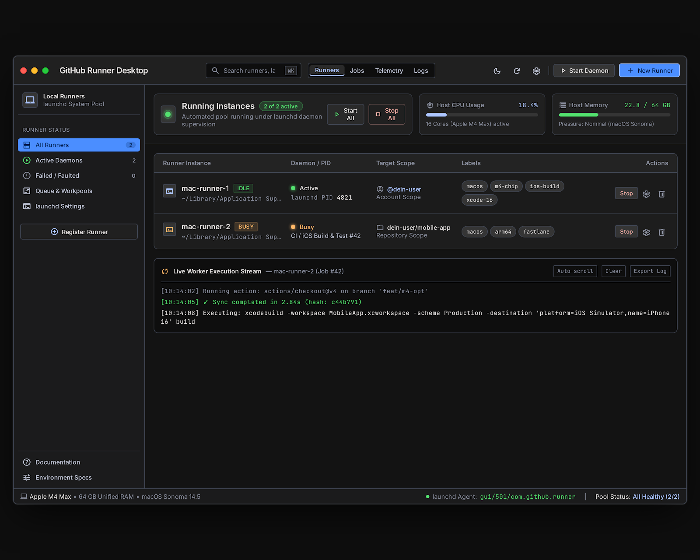
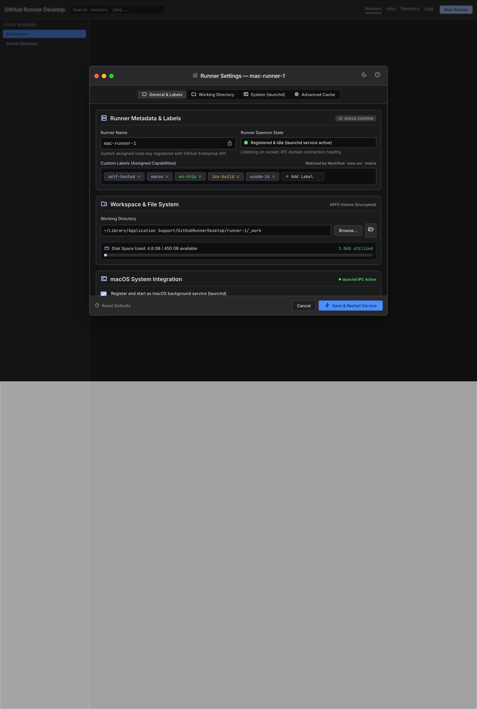
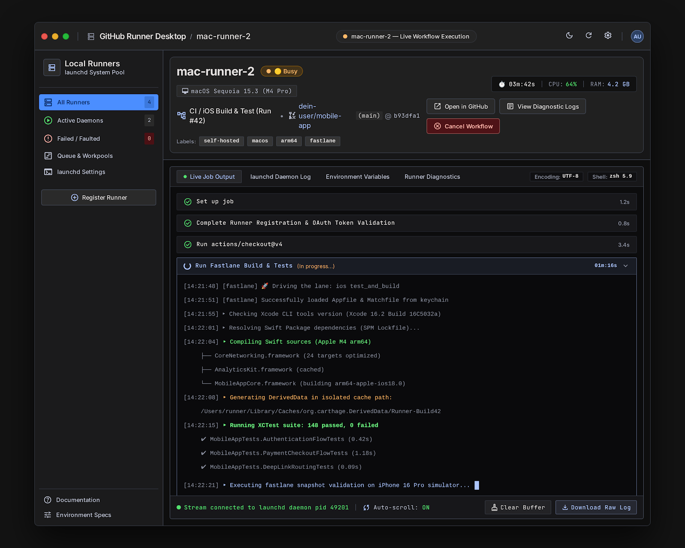
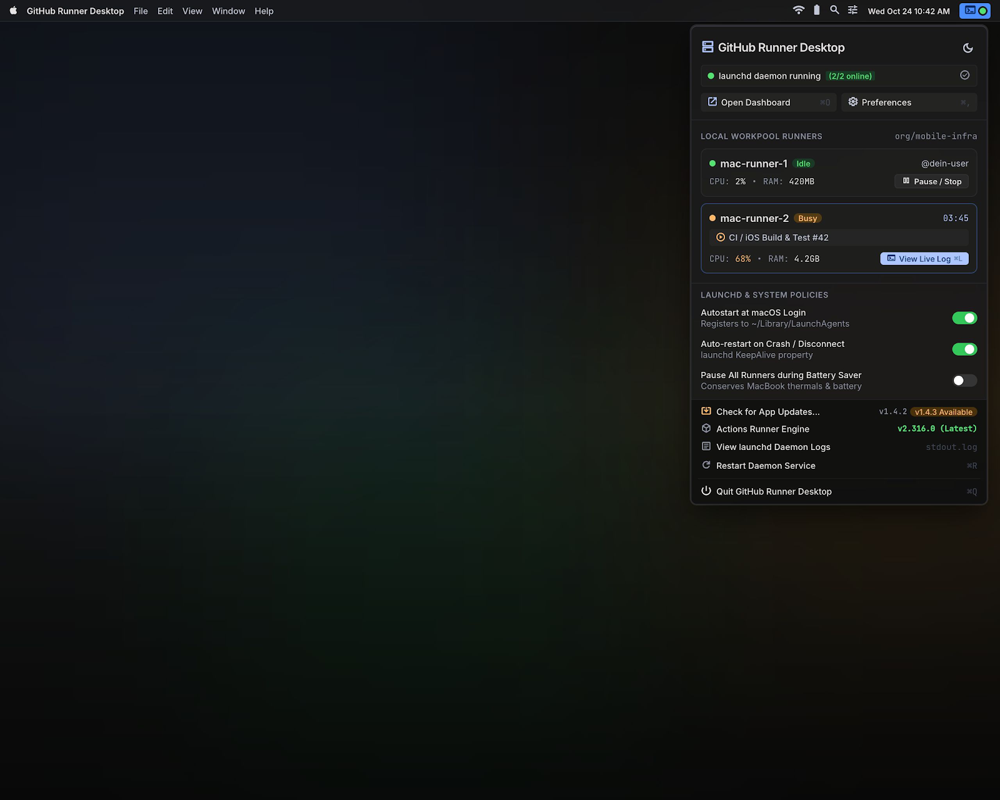

# 06 — Step 4: Main Dashboard, Runner Config & Labels, Live Logs & MenuBar (`v0.4.0`)

**Ziel von Step 4 (`v0.4.0`):**  
Vollständige Implementierung der täglichen Arbeits-Dialoge:
- **Dialog 2 (`2._main_dashboard_window`):** Haupt-Dashboard mit Pool-Status, Start/Stop-Steuerung, CPU/RAM-Kurztelemetrie und Live-Worker-Stream.
- **Dialog 4 (`4._advanced_runner_configuration_labels`):** Detail-Konfigurationssheet für einzelne Runner (Custom Labels Tag-Editor, Working Directory & Disk Usage, `launchd` Neustart).
- **Dialog 5 (`5._runner_detail_live_log_view`):** Vollbild-Detailansicht eines Runners mit Step-by-Step Job-Akkordeon, Echtzeit-ANSI-Terminal-Stream (`AsyncStream`) und `Cancel Workflow` / `Open in GitHub`.
- **Dialog 6 (`6._macos_menu_bar_status_item_popover`):** Natives macOS MenuBar-Popover (`MenuBarExtra(.window)`) für schnellen Zugriff aus der Menüleiste.

---

## 1. Dialog 2: Main Dashboard Window (`RunnerDashboardView.swift`)

### Funktionsumfang & SwiftUI-Umsetzung (`swiftui-pro` & `swiftdata-pro`)
1. **Left Sidebar (`NavigationSplitView` Source List):**
   - Filter-Kategorien mit Live-Badges: `All Runners`, `Active Daemons`, `Failed / Faulted`, `Queue & Workpools`, `launchd Settings`.
   - Nutzt sichere `#Predicate<RunnerEntity>`-Filter und `@Query` direkt in der View.
   - Unten: `+ Register Runner` Button (öffnet Wizard aus Step 3), `Documentation` & `Environment Specs`.
2. **Top KPI Cards (Bento Row):**
   - **Card 1 — Running Instances:** `2 of 2 active` mit globalen Quick-Action-Buttons **`▷ Start All`** und **`□ Stop All`**.
   - **Card 2 — Host CPU Usage:** Live-Prozentanzeige + Kern-Info (`Apple M-Series active`).
   - **Card 3 — Host Memory:** Live Unified Memory Balken (`22.8 / 64 GB — Pressure: Nominal`).
3. **Runner Instance Table:**
   - Zeigt pro Runner: Name + Status-Badge (`IDLE` grün / `BUSY` orange / `OFFLINE` grau / `FAULTED` rot), lokaler Pfad, `launchd PID` (oder aktueller Job-Name wie `CI / iOS Build & Test #42`), Target Scope (`@user` / `owner/repo`), **Label-Chips** (`macos`, `m4-chip`, `ios-build`, `xcode-16`, `fastlane`) und **Row Actions**:
     - `Stop` / `Start` Toggle-Button
     - `⚙️` (öffnet **Dialog 4: Runner Settings Sheet**)
     - `🗑️` (entfernt den Runner lokal via `./config.sh remove` + `launchctl bootout` und über die GitHub API)
4. **Embedded Live Worker Execution Stream (Bottom Panel):**
   - Zeigt für den ausgewählten Runner sofort die letzten Logzeilen aus `~/Library/Application Support/OctoRunner/runners/<name>/_diag/` bzw. `stdout.log` mit `Auto-scroll`, `Clear` und `Export Log`.

---

## 2. Dialog 4: Advanced Runner Configuration & Labels (`RunnerConfigDetailSheet.swift`)

Wird über das Zahnrad-Icon (`⚙️`) eines Runners geöffnet:
- **Sub-Navigation Tabs:** `General & Labels`, `Working Directory`, `System (launchd)`, `Advanced Cache`.
- **Runner Metadata & Labels:**
  - Read-only Runner Name & `launchd` Daemon State (`Registered & Idle`).
  - **Interaktiver Label-Tag-Editor (`TagFlowLayout`):** Bestehende Labels können per `×` entfernt und neue Labels über `+ Add Label` hinzugefügt werden.
  - **GitHub API Synchronisation:** Änderungen an den Labels werden direkt über `PUT /repos/{owner}/{repo}/actions/runners/{runner_id}/labels` (bzw. `/orgs/...`) mit GitHub synchronisiert!
- **Workspace & File System:**
  - Zeigt den `_work`-Pfad, einen `Browse...` / `Open in Finder`-Button und die aktuelle APFS-Speicherbelegung (`Disk Space Used: 4.8 GB / 450 GB available`).
- **Footer:** `Reset Defaults`, `Cancel` und **`⚡ Save & Restart Service`**.

---

## 3. Dialog 5: Runner Detail & Live Log View (`RunnerConsoleLogView.swift`)

Wird durch Doppelklick auf einen Runner oder Klick auf **"View Live Log"** geöffnet:
- **Runner Header Card:**
  - Name (`mac-runner-2`), Status-Pill (`Busy`), Laufzeit-Timer (`03m:42s`), CPU/RAM des Runner-Prozesses, verknüpfter Workflow-Run + Branch/Commit-Hash (`(main) @ b93dfa1`).
  - **Quick-Buttons:** `Open in GitHub` (öffnet den Workflow-Run im Browser), `View Diagnostic Logs` (öffnet `_diag` Ordner) und **`⊗ Cancel Workflow`** (sendet `POST /repos/{owner}/{repo}/actions/runs/{run_id}/cancel`).
- **4 Log-Ansichts-Tabs:**
  - `• Live Job Output` (mit ausklappbaren Workflow-Steps wie `Set up job`, `Run actions/checkout@v4`, `Run Fastlane Build & Tests`)
  - `launchd Daemon Log` (`stdout.log` / `stderr.log` des Daemons)
  - `Environment Variables` (injizierte Variablen wie `PATH`, `DEVELOPER_DIR`, `RUNNER_WORKSPACE`)
  - `Runner Diagnostics` (`Runner_*.log` und `Worker_*.log` aus `_diag/`)
- **Echtzeit Log-Streaming via `AsyncStream` (`swift-concurrency-pro`):**
  - `LogFileTailActor` überwacht die Logdateien effizient über `DispatchSource.makeFileSystemObjectSource` (Event-basiert, 0% CPU-Last im Idle) und streamt neue Zeilen inkl. ANSI-Farbcode-Highlighting an die UI.

---

## 4. Dialog 6: macOS Menu Bar Status Item Popover (`MenuBarPopoverView.swift`)

Implementiert als native SwiftUI `MenuBarExtra` mit `.menuBarExtraStyle(.window)`:
- **Header:** Status-Banner `• launchd daemon running (2/2 online)` + Buttons `Open Dashboard (⌘O)` & `Preferences (⌘,)`.
- **Local Workpool Runners Liste:**
  - Kompakte Karten für jeden Runner mit Status (`Idle` / `Busy`), aktuellem Job-Namen, CPU/RAM-Verbrauch und Direkt-Button `Pause / Stop` bzw. `View Live Log (⌘L)`.
- **`launchd` & System Policies Quick-Toggles:**
  - `Autostart at macOS Login` (`SMAppService.mainApp`)
  - `Auto-restart on Crash / Disconnect` (`KeepAlive` in Plist)
  - `Pause All Runners during Battery Saver` (`ProcessInfo.processInfo.isLowPowerModeEnabled`)
- **Footer-Menü:** `Check for App Updates...`, `Actions Runner Engine Version`, `View launchd Daemon Logs`, `Restart Daemon Service (⌘R)` und `Quit (⌘Q)`.

---

## 5. Umfang der ausführbaren Version `v0.4.0` (Was du nach Step 4 testen kannst)

1. Volle Kontrolle über alle Runner im **Main Dashboard** und aus der **macOS Menüleiste** (auch wenn das Hauptfenster geschlossen ist).
2. Live-Beobachtung laufender `xcodebuild`- und `fastlane`-Jobs im **Live Log View** inkl. Workflow-Abbruch und Label-Bearbeitung.
3. Veröffentlichung via `npm run release` als **`v0.4.0`** ins Homebrew Cask.
