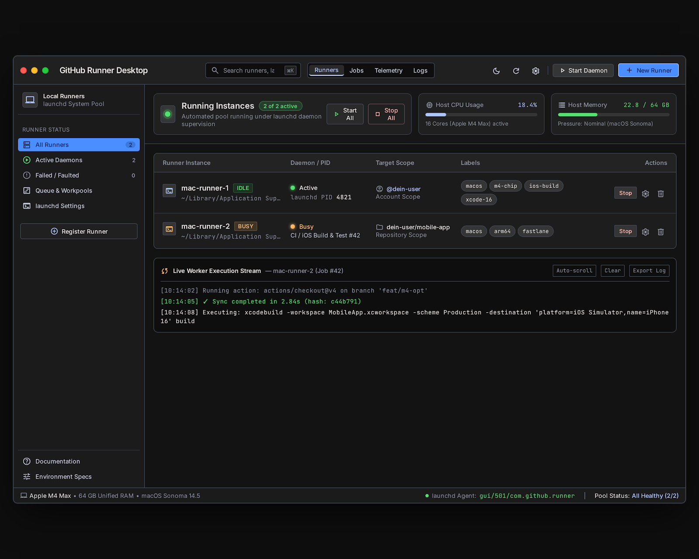
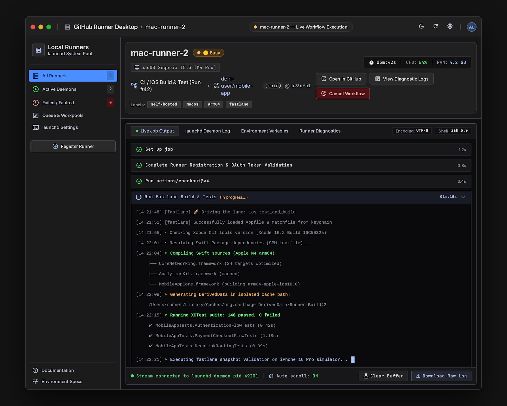
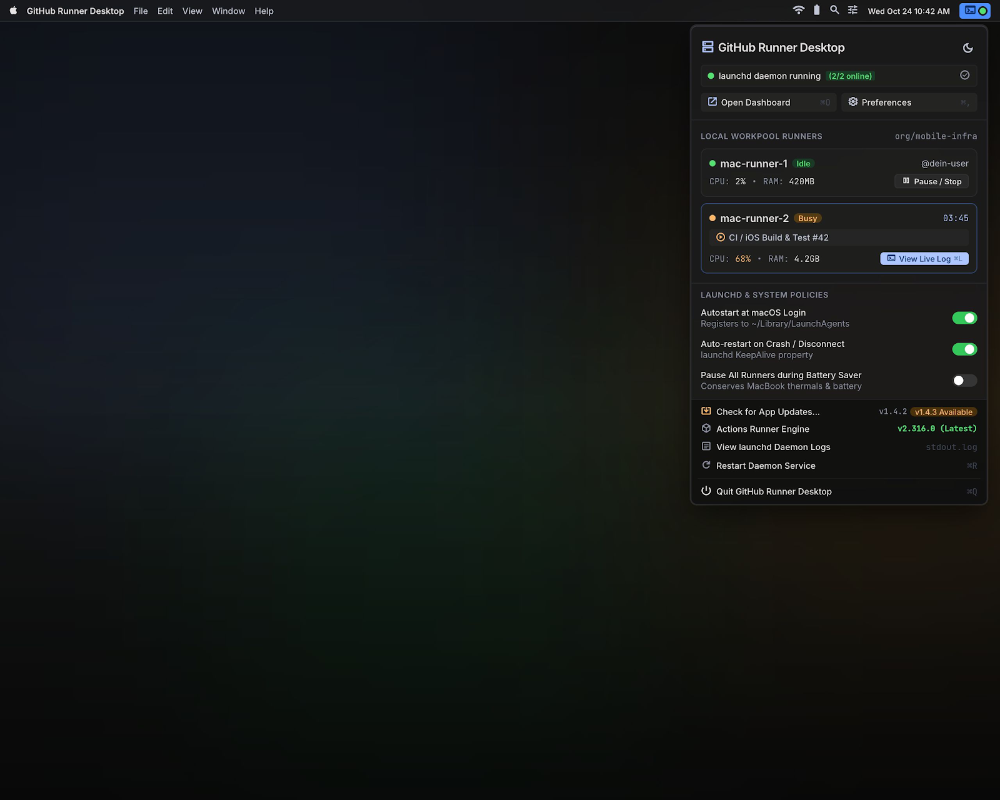

# 06 — Step 4: Main Dashboard, Runner Configuration, Live Logs, and Menu Bar (`v0.4.0`)

Step 4 (`v0.4.0`) implements the views for day-to-day runner management.

- **Dialog 2 (`2._main_dashboard_window`)** shows pool status, start and stop controls, CPU and memory summaries, and live worker output.
- **Dialog 4 (`4._advanced_runner_configuration_labels`)** lets you edit a runner’s labels, view its working directory and disk usage, and restart its `launchd` service.
- **Dialog 5 (`5._runner_detail_live_log_view`)** shows a full-screen runner detail view with expandable job steps, real-time ANSI terminal output from an `AsyncStream`, and **Cancel Workflow** and **Open in GitHub** actions.
- **Dialog 6 (`6._macos_menu_bar_status_item_popover`)** provides quick access from a native macOS menu bar popover (`MenuBarExtra(.window)`).

---

## 1. Dialog 2 — Main dashboard window (`RunnerDashboardView.swift`)

### Features and SwiftUI implementation (`swiftui-pro` and `swiftdata-pro`)

1. **Sidebar (`NavigationSplitView` source list)**
   - Filter categories with live badges include **All Runners**, **Active Daemons**, **Failed / Faulted**, **Queue & Workpools**, and **launchd Settings**.
   - The view uses safe `#Predicate<RunnerEntity>` filters and `@Query` directly.
   - The bottom of the sidebar contains **Documentation**, **Environment Specs**, and **+ Register Runner**, which opens the Step 3 wizard.
2. **Summary cards**
   - **Running Instances** shows a count such as `2 of 2 active` and the **▷ Start All** and **□ Stop All** shortcuts.
   - **Host CPU Usage** shows live CPU usage and core information such as `Apple M-Series active`.
   - **Host Memory** shows a live unified memory bar such as `22.8 / 64 GB — Pressure: Nominal`.
3. **Runner table**
   - Each row shows the runner name, status (**IDLE** in green, **BUSY** in orange, **OFFLINE** in gray, **FAULTED** in red), local path, `launchd` PID or current job name, target scope (`@user` or `owner/repo`), and label chips such as `macos`, `m4-chip`, `ios-build`, `xcode-16`, and `fastlane`.
   - **Stop** or **Start** toggles the runner. The gear opens **Dialog 4 — Runner Settings**. The trash button removes the local runner using `./config.sh remove` and `launchctl bootout`, and removes the registration through the GitHub API.
4. **Embedded live worker output**
   - The bottom panel shows recent log lines for the selected runner from `~/Library/Application Support/OctoRunner/runners/<name>/_diag/` or `stdout.log`, with **Auto-scroll**, **Clear**, and **Export Log** controls.

---

## 2. Dialog 4 — Advanced runner configuration and labels (`RunnerConfigDetailSheet.swift`)

Click a runner’s gear icon to open the sheet.

- The tabs are **General & Labels**, **Working Directory**, **System (launchd)**, and **Advanced Cache**.
- The runner name and `launchd` service status, such as `Registered & Idle`, are read-only.
- The label editor (`TagFlowLayout`) removes existing labels with **×** and adds labels with **+ Add Label**. It syncs changes to GitHub using `PUT /repos/{owner}/{repo}/actions/runners/{runner_id}/labels` or the corresponding `/orgs/...` endpoint.
- The workspace view shows the `_work` path, a **Browse...** or **Open in Finder** button, and current APFS disk usage such as `Disk Space Used: 4.8 GB / 450 GB available`.
- The footer offers **Reset Defaults**, **Cancel**, and **⚡ Save & Restart Service**.

---

## 3. Dialog 5 — Runner details and live logs (`RunnerConsoleLogView.swift`)

Double-click a runner or click **View Live Log** to open its details.

- The header shows the runner name, status, elapsed time, CPU and memory use, linked workflow run, branch, and commit hash. Example values include `mac-runner-2`, `Busy`, `03m:42s`, and `(main) @ b93dfa1`.
- **Open in GitHub** opens the associated repository or organization. **Diagnostic Folder (_diag)** opens the local folder on request. To open a specific workflow run on GitHub, use its run details in **Jobs & Workflow Runs**.
- Four views are available starting in v0.6.
  - **Live Runner Output** follows the process pipes for directly managed runners, service logs for LaunchAgents, and local diagnostic files for externally managed runners.
  - **Background Service Log** follows `_diag/launchd.stdout.log` and `_diag/launchd.stderr.log`.
  - **Environment Variables** shows the runner values known to OctoRunner and the configured working directory.
  - **Runner Diagnostics** shows a summary and follows the latest `Runner_*.log` and `Worker_*.log` files.
- File system events refresh the live view when files are written or rotated. Search, severity, pause, auto-scroll, and clear control what you see. The buffer retains up to 200 entries, and the app indicates when it has omitted content.
- Copy and export use the filtered view and mask recognized credentials. When an excerpt starts partway through a file and earlier context is unavailable, the export withholds that file’s text.
- **Jobs & Workflow Runs** shows steps reported by GitHub and loads available job logs. GitHub documents a separate download for job and step logs. [GitHub REST API](https://docs.github.com/en/rest/actions/workflow-jobs)

---

## 4. Dialog 6 — macOS menu bar popover (`MenuBarPopoverView.swift`)

The popover uses SwiftUI `MenuBarExtra` with `.menuBarExtraStyle(.window)`.

- The header shows a status banner such as `• launchd daemon running (2/2 online)` and the **Open Dashboard (⌘O)** and **Preferences (⌘,)** buttons.
- Each local runner card shows its status (**Idle** or **Busy**), current job name, CPU and memory usage, and actions such as **Pause / Stop** or **View Live Log (⌘L)**.
- System toggles include **Autostart at macOS Login** (`SMAppService.mainApp`), **Auto-restart on Crash / Disconnect** (`KeepAlive` in the plist), and **Pause All Runners during Battery Saver** (`ProcessInfo.processInfo.isLowPowerModeEnabled`).
- The footer menu includes **Check for App Updates...**, **Actions Runner Engine Version**, **View launchd Daemon Logs**, **Restart Daemon Service (⌘R)**, and **Quit (⌘Q)**.

---

## 5. What to test in `v0.4.0`

1. Control runners from the main dashboard and the macOS menu bar. Verify that menu bar controls remain accessible when the main window is closed.
2. Monitor running `xcodebuild` and `fastlane` jobs in the live log view, cancel a workflow, and edit runner labels.
3. Publish **`v0.4.0`** to the Homebrew cask with `npm run release`.
