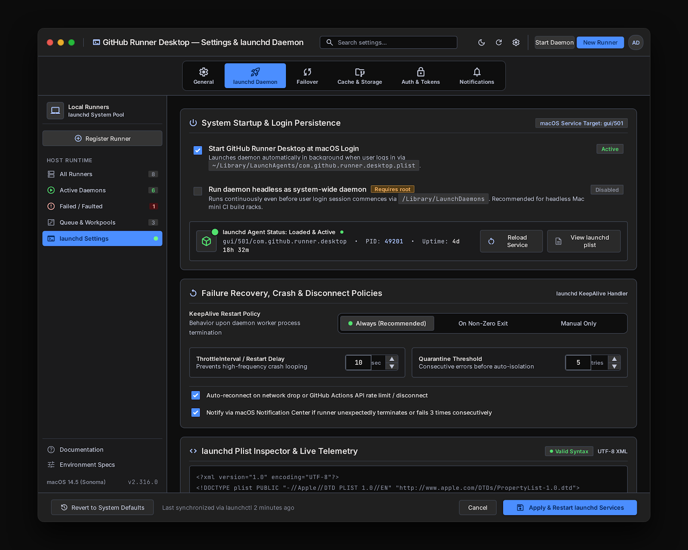
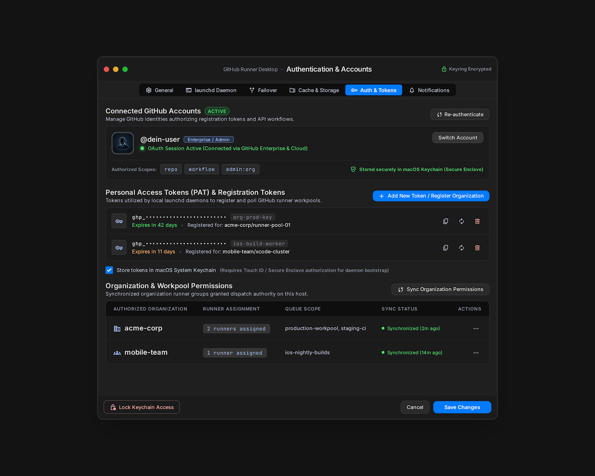
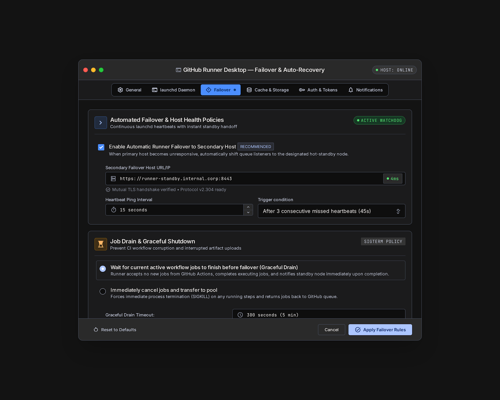
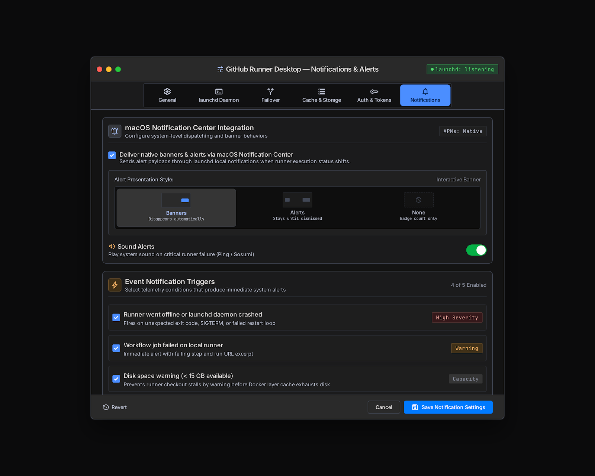
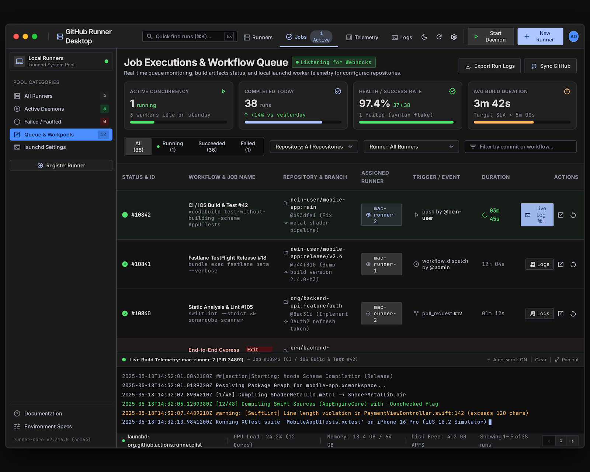
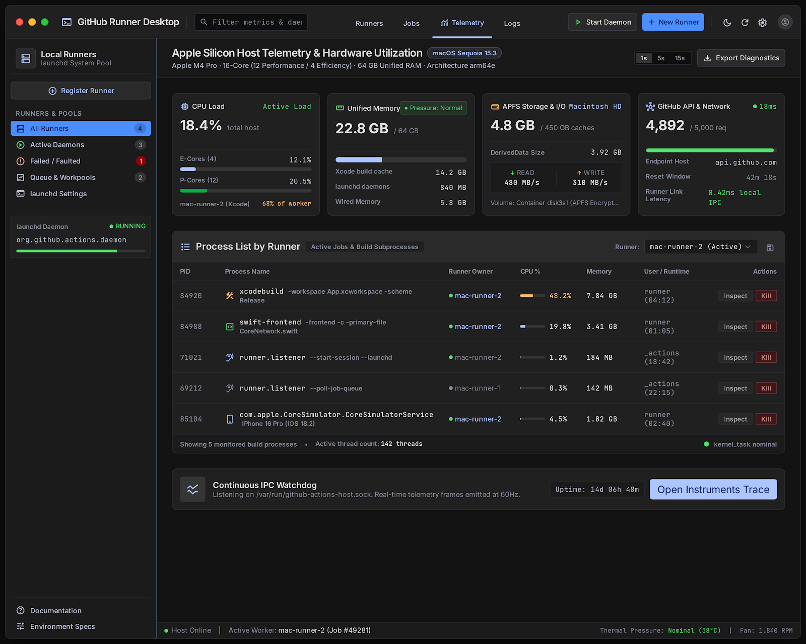

# 07 — Step 5: Settings (7a–7e), Jobs and Workflow Runs (8), and Host Telemetry (9) (`v0.5.0`)

> **Scope updated November 19, 2026.** The global concurrency limit moved to v0.6. See the [remaining delivery plan](./18-remaining-delivery-plan.md) for the current status and follow-up work.

Step 5 (`v0.5.0`) completes the remaining screens from the Stitch design.

- **Dialogs 7a–7e** provide six macOS Settings tabs. The tabs are **General**, **launchd Daemon**, **Failover**, **Cache & Storage**, **Auth & Tokens**, and **Notifications**.
- **Dialog 8 (`8._jobs_workflow_runs_view`)** provides global job history, queue monitoring, SLA and success metrics, and filtering across repositories and runners.
- **Dialog 9 (`9._host_telemetry_hardware_monitor`)** monitors Apple silicon hardware with efficiency and performance core usage, a unified memory breakdown, APFS read and write throughput, GitHub API rate limits, and a process inspector for each runner.

---

## 1. Dialogs 7a–7e — Settings (`SettingsWindowView.swift`)

````carousel

<!-- slide -->

<!-- slide -->

<!-- slide -->

````

### Tab 7a — General and app behavior (`GeneralSettingsTab.swift`)

- **Launch at System Login** uses `SMAppService.mainApp.register()`.
- System integration includes **Show icon in macOS Menu Bar** and **Hide dock icon when window is closed** (`NSApp.setActivationPolicy(.accessory)`).
- The language selector (`AppLanguage`) offers **System Default (macOS)**, **English (United States)**, and **Deutsch (Deutschland)** through the string catalog (`Localizable.xcstrings`).
- The update section shows the app version and installed GitHub Actions runner engine version, with a **Check Now** button.

### Tab 7 — Autostart and background (`BackgroundSettingsTab.swift`)

- The app’s login item and the runners’ LaunchAgents have separate settings.
- Expanding a runner row checks the service ID, current status, PID, and uptime for `gui/<uid>/io.octorunner.agent.*`. You can also refresh the check manually.
- **Load service** loads an unloaded, verified LaunchAgent. OctoRunner checks the managed directory and whether a listener is already running there. A loaded service can continue executing active jobs.
- The plist inspector shows the associated installed plist as XML you can copy. Missing, invalid, and unrecognized files each have their own status message.
- The runner concurrency stepper, available in v0.6 and later, limits directly managed runners to 1 through 64, with a default of 4. A slot stays reserved from the start attempt until the process exits and is released if startup fails.
- Lowering the limit lets running runners continue. Pending starts wait in queue order and can be canceled in runner details.
- LaunchAgents and external runners manage their processes independently. GitHub continues to assign workflow jobs to available online runners.
- New runners use the default shell and inherit the host `PATH`, including Homebrew tools.
- Failure recovery and KeepAlive policies are planned for the separate **Failover** section.

### Tab 7b — Cache and storage (`StoragePruningTab.swift`)

- The APFS storage bar shows three categories.
  1. `_work/` for Git repositories and job workspaces.
  2. `_actions/` and `_temp/` for Marketplace actions and step scripts.
  3. Host dependency caches, including `~/Library/Developer/Xcode/DerivedData` and `~/.cache`.
- **🗑️ Purge Inactive Build Caches Now** safely removes orphaned `_temp`, old `_work` directories, and optionally `DerivedData` when there are no busy runners.
- Automated pruning (`WorkspaceCleanerActor`) offers **Prune when host disk space falls below 20 GB (Recommended)**, **Automatically purge _temp and inactive _work older than 7 days**, and **Manual prune only**.

### Tab 7c — Auth and tokens (`SecurityTokenSettingsTab.swift`)

- The account view shows the active OAuth account’s username, avatar, and verified scopes (`repo`, `workflow`, `admin:org)), with **Re-authenticate** and **Switch Account** actions.
- The token list shows expiration dates and lets you rotate or delete saved PATs in the Keychain. **Require Touch ID / Secure Enclave authorization for token inspection** uses `LAContext` and follows `swift-security-expert`.
- The permissions table lists authorized organizations and repositories, counts assigned runners, and provides **Sync Organization Permissions**.

### Tab 7d — Failover and graceful drain (`FailoverSettingsTab.swift`)

- The planned `SIGTERM` shutdown policy offers **Wait for current active workflow jobs to finish before stopping/restarting (Graceful Drain)** with a configurable timeout such as `300 seconds` and **Immediately cancel jobs (SIGKILL)**.
- A standby host configuration section previews secondary failover for phase 2.

### Tab 7e — Notifications and alerts (`AlertsSettingsTab.swift`)

- Notification Center integration (`UNUserNotificationCenter`) provides banner and alert settings plus a sound toggle (`Ping` or `Sosumi`).
- Event triggers include **Runner went offline or launchd daemon crashed** (**High Severity**), **Workflow job failed on local runner** (**Warning**), and **Disk space warning (< 15 GB available)** (**Capacity**).

---

## 2. Dialog 8 — Jobs and workflow runs (`WorkflowJobHistoryView.swift`)



Open the **Jobs** tab or the **Queue & Workpools** sidebar item.

- Four cards summarize **ACTIVE CONCURRENCY** (such as `1 running`, `3 workers idle on standby`), **COMPLETED TODAY** (run count and trend), **HEALTH / SUCCESS RATE** (such as `97.4%`), and **AVG BUILD DURATION** (such as `3m 42s`).
- The filter bar offers **All**, **Running**, **Succeeded**, and **Failed** status choices, repository and runner dropdowns, and a text search for commit hashes or workflow names.
- The table uses SwiftData and syncs with the GitHub Actions Runs API. It shows the run ID (`#10842`), workflow and command (`CI / iOS Build & Test`), repository, branch and commit (`main @ b93dfa1`), assigned runner (`mac-runner-2`), trigger (`push`, `pull_request`, or `workflow_dispatch`), and duration. **Live Log (⌘L)** or **Logs** opens the corresponding log view.

---

## 3. Dialog 9 — Host telemetry and hardware monitor (`HostTelemetryDashboardView.swift`)



Open the **Telemetry** tab to see Apple silicon hardware metrics from `HostTelemetryActor` in `TelemetryKit`.

1. **CPU Load** shows total usage and a breakdown by efficiency (E) and performance (P) cores. It uses the `host_processor_info` Mach API and `sysctlbyname("hw.perflevel0.physicalcpu")` and `perflevel1`.
2. **Unified Memory** shows used and total memory (`host_statistics64` and `vm_statistics64`), thermal state and memory pressure (`ProcessInfo.processInfo.thermalState` and memory pressure data), and a breakdown by Xcode build cache, `launchd` daemons, and wired memory.
3. **APFS Storage & I/O** shows cache usage, `DerivedData` size calculated with `FileManager` in a background actor, and read and write throughput.
4. **GitHub API & Network** shows the current rate limit from `X-RateLimit-Remaining` and `X-RateLimit-Limit`, such as `4,892 / 5,000 req`, the reset countdown, and ping latency to `api.github.com`.

The process inspector lists active runner daemon child processes such as `xcodebuild`, `swift-frontend`, `Runner.Listener`, and `CoreSimulatorService`. Each row shows the PID, associated runner, CPU usage, memory, and elapsed time, with **Inspect** and **Kill** (`kill(pid, SIGTERM)`) actions.

---

## 4. What to test in `v0.5.0`

1. Review all nine screen groups from the Stitch design.
2. Verify automatic storage pruning, native macOS notifications for failed builds and low disk space, full job history, and real-time Apple silicon telemetry.
3. Publish **`v0.5.0`** to the Homebrew cask with `npm run release`.
