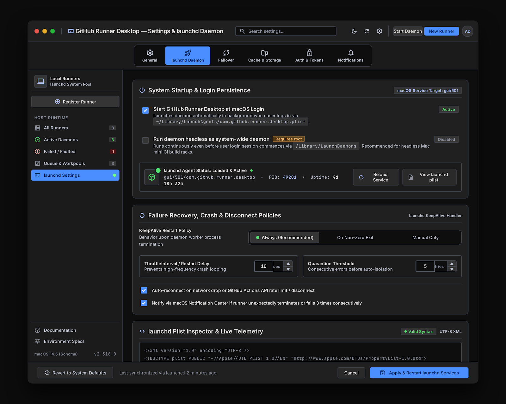
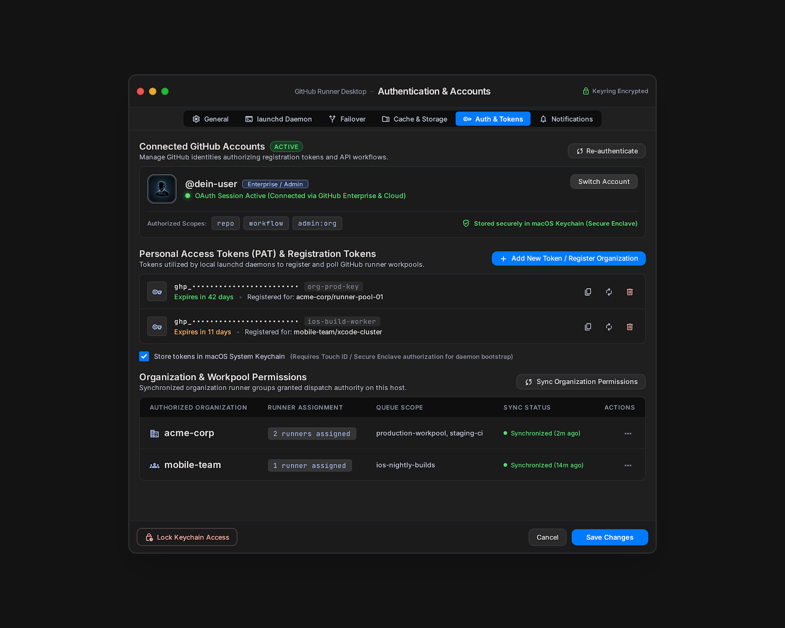
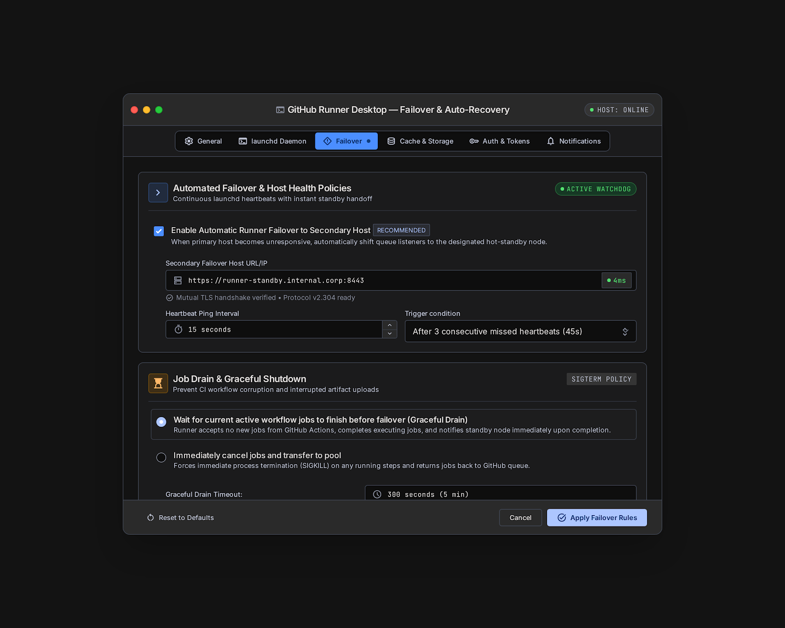
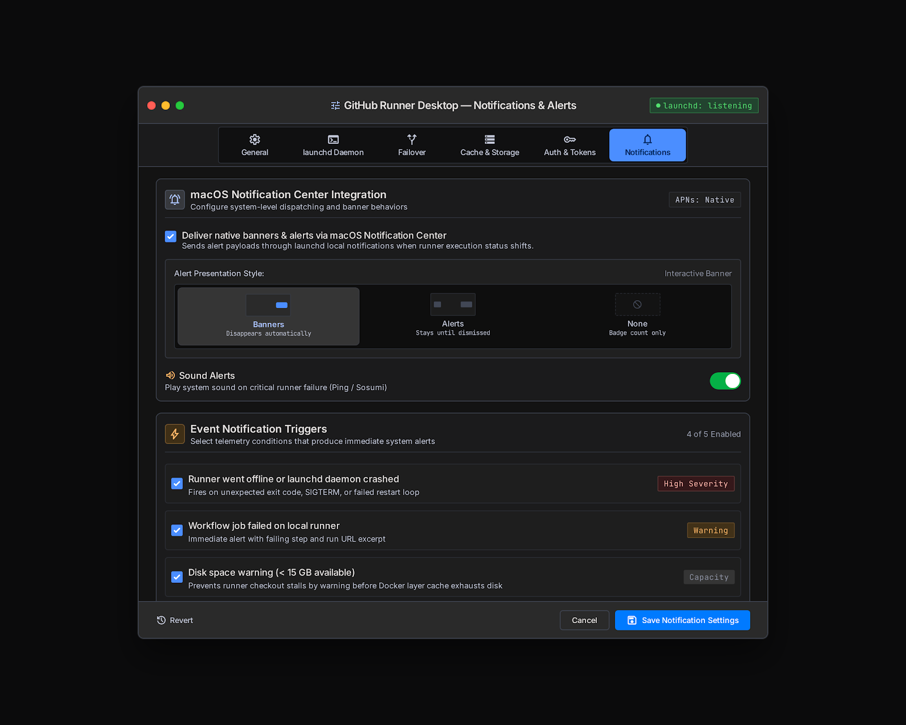
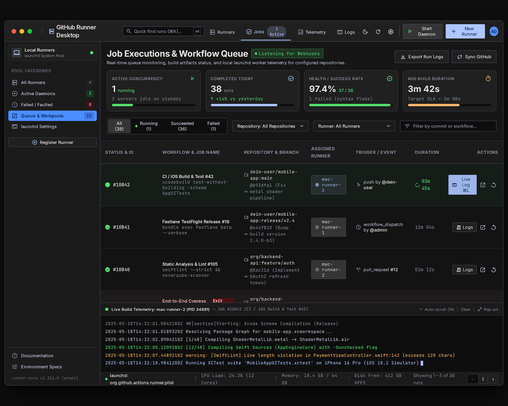
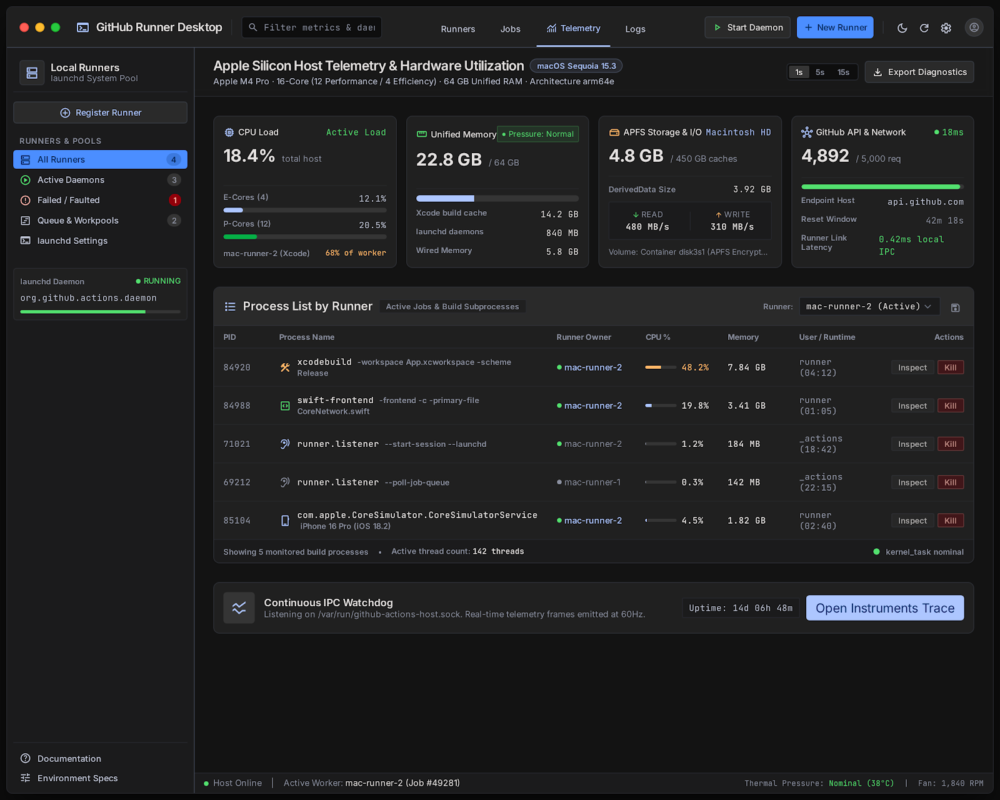

# 07 — Step 5: Settings Suite (7a–7e), Jobs & Workflow Runs (8) & Host Telemetry (9) (`v0.5.0`)

**Ziel von Step 5 (`v0.5.0`):**  
Vervollständigung aller verbleibenden Screens aus deinem Stitch-Design:
- **Dialoge 7a–7e:** Das 6-Tab macOS Settings-Fenster (`General`, `launchd Daemon`, `Failover`, `Cache & Storage`, `Auth & Tokens`, `Notifications`).
- **Dialog 8 (`8._jobs_workflow_runs_view`):** Globale Job-Historie, Queue-Monitoring, SLA/Erfolgs-Metriken und Filterung über alle Repositories und Runner.
- **Dialog 9 (`9._host_telemetry_hardware_monitor`):** Apple Silicon Hardware-Monitor (E-Cores vs. P-Cores, Unified Memory Breakdown, APFS Read/Write I/O, GitHub API Rate-Limit & Prozess-Inspektor pro Runner).

---

## 1. Dialoge 7a–7e: Die Settings-Suite (`SettingsWindowView.swift`)

````carousel

<!-- slide -->

<!-- slide -->

<!-- slide -->

````

### Tab 7a: General & App Behavior (`GeneralSettingsTab.swift`)
- **System Integration:**
  - `Launch at System Login` via `SMAppService.mainApp.register()`.
  - `Show icon in macOS Menu Bar` & `Hide dock icon when window is closed (NSApp.setActivationPolicy(.accessory))`.
- **Sprachauswahl (`AppLanguage`):** `System Default (macOS)`, `English (United States)`, `Deutsch (Deutschland)` via String Catalog (`Localizable.xcstrings`).
- **Update Channel & Engine Info:** Anzeige der App-Version + installierten GitHub Actions Runner Engine Version + Button `Check Now`.
- **Global Runner Concurrency & Shell:**
  - Stepper für maximale parallele Runner (passend zur Apple Silicon Kernanzahl).
  - Standard-Shell (`/bin/zsh`, `/bin/bash`, `/opt/homebrew/bin/bash`) + Toggle `Inherit host PATH and Homebrew binaries (/opt/homebrew/bin)`.
  - Log-Retention (`7`, `14`, `30`, `90` Tage).

### Tab 7: `launchd` Daemon & Auto-Recovery (`LaunchdSettingsTab.swift`)
- **System Startup & Login Persistence:**
  - Status-Anzeige `gui/<uid>/io.octorunner.agent.*` mit `PID`, `Uptime` sowie Buttons `Reload Service` und `View launchd plist`.
  - *(Hinweis gemäß unserer Abstimmung: Die Checkbox "Run daemon headless as system-wide root daemon" ist sichtbar, aber als `Phase 2 / Pro` gekennzeichnet, da User-LaunchAgents für Xcode/iOS-Simulatoren der empfohlene Standard sind).*
- **Failure Recovery & KeepAlive Policies:**
  - `KeepAlive Restart Policy`: `Always (Recommended)`, `On Non-Zero Exit`, `Manual Only`.
  - `ThrottleInterval / Restart Delay` (Standard: `10 sec`) & `Quarantine Threshold` (`5 tries`).
- **Live `launchd` Plist Inspector:**
  - Read-only XML-Vorschau der generierten `.plist` mit Syntax-Validierungs-Badge (`Valid Syntax`).

### Tab 7b: Cache & Storage (`StoragePruningTab.swift`)
- **Disk Space & APFS Storage Allocation:**
  - Dreigeteilte Fortschrittsleiste:
    1. `_work/` (Git Repositories & Job Workspaces)
    2. `_actions/` & `_temp/` (Marketplace Actions & Step Scripts)
    3. Host Dependency Caches (`~/Library/Developer/Xcode/DerivedData`, `~/.cache`)
  - Button **`🗑️ Purge Inactive Build Caches Now`** (löscht sicher verwaiste `_temp`, alte `_work` Ordner und optional `DerivedData`, sofern kein Runner gerade `busy` ist).
- **Automated Pruning Policy (`WorkspaceCleanerActor`):**
  - Radio-Auswahl: `Prune when host disk space falls below 20 GB (Recommended)`, `Automatically purge _temp and inactive _work older than 7 days`, oder `Manual prune only`.

### Tab 7c: Auth & Tokens (`SecurityTokenSettingsTab.swift`)
- **Connected GitHub Accounts:**
  - Zeigt den aktiven OAuth-Account (`@username`, Avatar, verifizierte Scopes `repo`, `workflow`, `admin:org`) + Buttons `Re-authenticate` & `Switch Account`.
- **Personal Access Tokens & Keychain Security (`swift-security-expert`):**
  - Liste hinterlegter PATs mit Ablaufdatum-Anzeige, Rotation und Löschung aus dem Keychain.
  - Toggle: `Require Touch ID / Secure Enclave authorization for token inspection` (`LAContext`).
- **Organization & Workpool Permissions Table:**
  - Übersicht der autorisierten Organisationen/Repos inkl. Anzahl zugewiesener Runner und Button `Sync Organization Permissions`.

### Tab 7d: Failover & Graceful Drain (`FailoverSettingsTab.swift`)
- **Job Drain & Graceful Shutdown (`SIGTERM` Policy):**
  - `Wait for current active workflow jobs to finish before stopping/restarting (Graceful Drain)` mit konfigurierbarem Timeout (`300 seconds`) vs. `Immediately cancel jobs (SIGKILL)`.
- **Secondary Failover Host (Phase 2 Preview):**
  - UI-Sektion für Standby-Host-Konfiguration (als Phase-2-Erweiterung vorbereitet).

### Tab 7e: Notifications & Alerts (`AlertsSettingsTab.swift`)
- **macOS Notification Center Integration (`UNUserNotificationCenter`):**
  - Banner/Alert-Konfiguration + Sound-Alert Toggle (`Ping` / `Sosumi`).
- **Event Notification Triggers:**
  - ✅ `Runner went offline or launchd daemon crashed` (`High Severity`)
  - ✅ `Workflow job failed on local runner` (`Warning`)
  - ✅ `Disk space warning (< 15 GB available)` (`Capacity`)

---

## 2. Dialog 8: Jobs & Workflow Runs View (`WorkflowJobHistoryView.swift`)



Erreichbar über den Top-Navigation-Tab **"Jobs"** oder Sidebar **"Queue & Workpools"**:
- **4 Top-KPI-Karten:**
  1. `ACTIVE CONCURRENCY` (`1 running`, `3 workers idle on standby`)
  2. `COMPLETED TODAY` (Anzahl Runs + Trend)
  3. `HEALTH / SUCCESS RATE` (z.B. `97.4%` Erfolgsquote)
  4. `AVG BUILD DURATION` (z.B. `3m 42s`)
- **Filter-Leiste:**
  - Status-Segmente (`All`, `Running`, `Succeeded`, `Failed`), Dropdowns für `Repository` und `Runner` sowie Freitext-Suche nach Commit-Hash oder Workflow-Name.
- **Workflow Runs Tabelle (`SwiftData` + GitHub Actions Runs API Sync):**
  - Zeigt Run-ID (`#10842`), Workflow & Befehl (`CI / iOS Build & Test`), Repo + Branch + Commit (`main @ b93dfa1`), zugewiesenen Runner (`mac-runner-2`), Trigger (`push`, `pull_request`, `workflow_dispatch`), Dauer und Direkt-Button `Live Log (⌘L)` bzw. `Logs`.

---

## 3. Dialog 9: Host Telemetry & Hardware Monitor (`HostTelemetryDashboardView.swift`)



Erreichbar über den Top-Navigation-Tab **"Telemetry"**:
- **Apple Silicon Hardware Cards (`HostTelemetryActor` in `TelemetryKit`):**
  1. **CPU Load:** Gesamtlast in % + Aufschlüsselung nach **E-Cores (Efficiency)** und **P-Cores (Performance)** via `host_processor_info` Mach-API (`sysctlbyname("hw.perflevel0.physicalcpu")` / `perflevel1`).
  2. **Unified Memory:** Belegter vs. gesamter RAM (`host_statistics64` `vm_statistics64`), Memory Pressure Status (`ProcessInfo.processInfo.thermalState` & Memory-Pressure), Aufschlüsselung nach `Xcode build cache`, `launchd daemons` und `Wired Memory`.
  3. **APFS Storage & I/O:** Belegter Cache-Speicher, `DerivedData`-Größe (`FileManager` Größenberechnung im Background-Actor) sowie Read/Write-Durchsatz.
  4. **GitHub API & Network:** Aktuelles Rate-Limit aus den GitHub-API-Headern (`X-RateLimit-Remaining` / `X-RateLimit-Limit`, z.B. `4,892 / 5,000 req`), Reset-Countdown (`42m 18s`) und Ping-Latenz zu `api.github.com`.
- **Process List by Runner (Child-Process Inspector):**
  - Listet alle aktiven Kindprozesse unserer Runner-Daemons auf (z.B. `xcodebuild`, `swift-frontend`, `Runner.Listener`, `CoreSimulatorService`) mit `PID`, zugehörigem Runner (`mac-runner-2`), `CPU %`, `Memory`, Laufzeit und Buttons **`Inspect`** & **`Kill`** (`kill(pid, SIGTERM)`).

---

## 4. Umfang der ausführbaren Version `v0.5.0` (Was du nach Step 5 testen kannst)

1. Vollständige App mit allen 9 Screen-Gruppen aus deinem Stitch-Design.
2. Automatische Speicherbereinigung (`Pruning`), native macOS-Mitteilungen bei fehlgeschlagenen Builds oder knappem Speicherplatz, komplette Job-Historie und Echtzeit-Apple-Silicon-Telemetrie.
3. Veröffentlichung via `npm run release` als **`v0.5.0`** ins Homebrew Cask.
