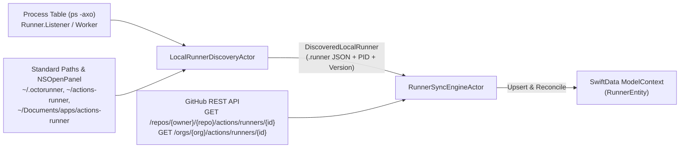

# 08 — `SyncKit`: Local Runner Auto-Discovery & GitHub Remote Reconciliation

> **Module:** `SyncKit` (`Packages/OctoRunnerKit/Sources/SyncKit`)
> **Test Suite:** `SyncKitTests.swift` (`Packages/OctoRunnerKit/Tests/OctoRunnerKitTests/SyncKitTests.swift`)
> **Goal:** Automatically discover existing self-hosted GitHub Actions runners on the local Mac (such as `~/Documents/apps/actions-runner` or `~/actions-runner`), reconcile them with the GitHub Actions REST API, and import/synchronize them into SwiftData (`RunnerEntity`).

---

## 1. Problem Statement & Real-World Analysis

Users migrating to **OctoRunner** frequently already have one or more configured GitHub Actions runners on their Mac (e.g., `/Users/frank/Documents/apps/actions-runner`).

### Anatomy of an Existing Local Runner Directory
When GitHub's `config.sh` registers a runner, it writes the following files into the runner root directory:
- **`.runner`** (JSON encoded with a **.NET UTF-8 Byte Order Mark `0xEF 0xBB 0xBF`**):
  ```json
  {
    "agentId": 21,
    "agentName": "macbook-pro-frank",
    "poolId": 1,
    "poolName": "Default",
    "serverUrl": "https://pipelinesghubeus25.actions.githubusercontent.com/...",
    "gitHubUrl": "https://github.com/loesch-digital/itemflux-ios-app",
    "workFolder": "_work",
    "useV2Flow": true,
    "serverUrlV2": "https://broker.actions.githubusercontent.com/"
  }
  ```
- **`bin` symlink** (e.g., `bin -> /Users/.../actions-runner/bin.2.338.2`), which encodes the exact installed runner version (`2.338.2`).
- **`_diag/`** directory containing `Runner_*.log` and `Worker_*.log` diagnostic logs.
- **Active Process:** When running, `/bin/ps -axo pid=,command=` shows:
  - `<PID> /path/to/actions-runner/bin/Runner.Listener run` (Idle / Listening)
  - `<PID> /path/to/actions-runner/bin/Runner.Worker ...` (Busy / Executing Job)

> [!CAUTION]
> **Security Rule (`swift-security-expert`):** `SyncKit` must **never** read, copy, or log `.credentials_rsaparams` (the runner's private RSA key). It only inspects the non-secret `.runner` metadata file and process table.

---

## 2. `SyncKit` Architecture



### 2.1 Core Types (`SyncModels.swift`)
1. **`LocalDotRunnerConfig` (`Codable, Sendable, Equatable`):**
   - Decodes `.runner` after stripping any leading UTF-8 BOM (`0xEF, 0xBB, 0xBF`).
   - Fields: `agentId: Int64`, `agentName: String`, `poolId: Int?`, `poolName: String?`, `gitHubUrl: URL`, `workFolder: String`.
   - Computed properties:
     - `inferredScopeType: RunnerScopeType` (`.repository` if `gitHubUrl.pathComponents.count >= 3`, `.organization` if `== 2`).
     - `ownerAndRepo: (owner: String, repo: String?)?` extracted from `gitHubUrl`.
2. **`DiscoveredLocalRunner` (`Sendable, Equatable`):**
   - `rootDirectory: URL`
   - `config: LocalDotRunnerConfig`
   - `workDirectory: URL`
   - `runnerVersion: String?` (parsed from `bin` symlink target `bin.X.Y.Z`)
   - `listenerPID: Int32?`
   - `isWorkerActive: Bool`
   - `localStatus: RunnerStatus` (`.busy` if worker active, `.idle` if listener PID active, `.offline` otherwise)
3. **`GitHubRemoteRunnerDTO` (`Codable, Sendable, Equatable`):**
   - Decodes GitHub REST API response from `GET /repos/{owner}/{repo}/actions/runners/{runner_id}` or `GET /repos/{owner}/{repo}/actions/runners`:
     - `id: Int64`, `name: String`, `os: String`, `status: String` (`"online"` / `"offline"`), `busy: Bool`, `labels: [GitHubRunnerLabelDTO]`.

### 2.2 Actors (`SyncKit`)
1. **`LocalRunnerDiscoveryActor`:**
   - **Step 1 (Active Process Discovery):** Runs `/bin/ps -axo pid=,command=` to find any running `Runner.Listener` and `Runner.Worker` processes. From `<path>/bin/Runner.Listener`, derives the runner root directory (`<path>`) and live `PID`.
   - **Step 2 (Filesystem Discovery):** Scans standard candidate directories (`~/actions-runner`, `~/Documents/apps/actions-runner`, `~/Documents/actions-runner`, `~/.octorunner/runners/*`, plus any user-supplied directory URLs) for `.runner`.
   - **Step 3 (BOM-safe Decoding):** Strips UTF-8 BOM (`0xEF, 0xBB, 0xBF`) if present, decodes `LocalDotRunnerConfig`, resolves `bin` symlink version, and returns `[DiscoveredLocalRunner]`.
2. **`GitHubRunnerSyncActor`:**
   - Given a `[DiscoveredLocalRunner]` and an optional GitHub OAuth/PAT token (from `KeychainVaultActor`), queries GitHub REST API (`GET /repos/{owner}/{repo}/actions/runners/{agentId}` or `/orgs/{org}/actions/runners/{agentId}`) to enrich each discovered runner with its remote `labels` (e.g., `["self-hosted", "macOS", "ARM64"]`) and remote `busy`/`status` state.
   - Gracefully falls back to local metadata (`["self-hosted", "macos", "arm64"]`) if offline or if the token lacks admin access to that repo.

---

## 3. TDD Test Strategy (Red → Green → Refactor)

In `Packages/OctoRunnerKit/Tests/OctoRunnerKitTests/SyncKitTests.swift`:
1. **`dotRunnerBOMDecodingAndScopeInference`:**
   - Verifies that `.runner` data prefixed with UTF-8 BOM (`0xEF, 0xBB, 0xBF`) decodes `agentId`, `agentName`, `gitHubUrl`, `workFolder`, and correctly infers `.repository` (`loesch-digital/itemflux-ios-app`) vs `.organization` (`loesch-digital`).
2. **`processTableOutputParsing`:**
   - Feeds sample `ps -axo pid=,command=` output containing `87558 /Users/frank/Documents/apps/actions-runner/bin/Runner.Listener run` and verifies extraction of `rootDirectory == /Users/frank/Documents/apps/actions-runner` and `pid == 87558`.
3. **`filesystemRunnerDiscoveryInTempDirectory`:**
   - Creates a temporary runner folder with a BOM-prefixed `.runner` file and `bin -> bin.2.338.2` symlink, runs `LocalRunnerDiscoveryActor`, and verifies `agentId`, `runnerVersion == "2.338.2"`, and `workDirectory`.
4. **`githubRemoteRunnerDTODecoding`:**
   - Decodes GitHub REST API JSON for `/repos/{owner}/{repo}/actions/runners/{id}` and extracts label names.

---

## 4. Audit-Log Datenmodell (`AuditLogEntity` & `AuditLogRecorder`)

Für Konfigurationsänderungen, Runner-Lifecycle-Events (Auto-Import, Provisioning, Löschung) und System-/Auth-Ereignisse enthält `CoreModels` die dedizierte SwiftData-Tabelle **`AuditLogEntity`**:

| Feld | Typ | Beschreibung |
| :--- | :--- | :--- |
| `id` | `UUID` | Eindeutige Event-ID (`= UUID()`) |
| `timestamp` | `Date` | Zeitstempel des Ereignisses (`= Date.now`) |
| `categoryRaw` / `category` | `AuditEventCategory` | `.authentication`, `.runnerLifecycle`, `.configuration`, `.appUpdate`, `.system` |
| `severityRaw` / `severity` | `AuditEventSeverity` | `.info`, `.warning`, `.critical` |
| `title` | `String` | Kurzer Event-Titel (z. B. `"Local Runner Auto-Imported"`, `"Runner Labels Updated"`) |
| `summary` | `String` | Detailbeschreibung (**Bewusst `summary` statt `description` genannt**, da `description` in `@Model`-Klassen laut `swiftdata-pro` verboten ist) |
| `actorAccountLogin` | `String?` | Ausführender GitHub-Account (z. B. `"loesch-digital"`) |
| `targetRunnerName` | `String?` | Betroffene Runner-Instanz (z. B. `"macbook-pro-frank"`) |
| `previousValue` | `String?` | Alter Konfigurationswert vor der Änderung (für Diff-Ansicht im späteren Audit-Dialog) |
| `newValue` | `String?` | Neuer Konfigurationswert nach der Änderung |

> [!NOTE]
> **Einhaltung von `swiftdata-pro` (`references/indexing.md` & `references/core-rules.md`):**
> - Auf `AuditLogEntity` wird bewusst **kein `#Index`** gesetzt, da `swiftdata-pro` für schreibintensive Logging-Tabellen explizit vom Indexing abrät (*"if data is read rarely and updated frequently (such as logging), indexes may be a bad choice"*).
> - Alle Properties besitzen Property-Level-Defaultwerte, damit Lightweight-Migrationen (`OctoRunnerPersistence.makeSharedContainer()`) niemals fehlschlagen.

