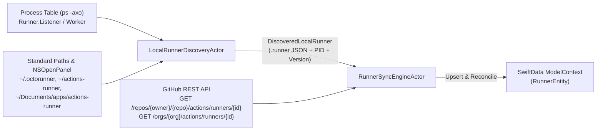

# 08 — `SyncKit`: Local Runner Auto-Discovery & GitHub Remote Reconciliation

> **Module:** `SyncKit` (`Packages/OctoRunnerKit/Sources/SyncKit`)
> **Test Suite:** `SyncKitTests.swift` (`Packages/OctoRunnerKit/Tests/OctoRunnerKitTests/SyncKitTests.swift`)
> **Goal:** Automatically discover existing self-hosted GitHub Actions runners on the local Mac (such as `~/Documents/apps/actions-runner` or `~/actions-runner`), reconcile them with the GitHub Actions REST API, and import/synchronize them into SwiftData (`RunnerEntity`).

> **Privacy correction (v0.4.4):** External paths such as Documents are inspected only after explicit selection using **Import Folder…**. Automatic discovery is limited to `~/actions-runner`, `~/.octorunner/runners/*`, and `~/Library/Application Support/io.octorunner.macos/runners/*`. Process-table paths alone do not authorize filesystem reads. External embedded logs require a user action. The automatic Documents scanning described below is historical and superseded by [the privacy audit](./09-pipeline-privacy-and-test-audit.md).

## Migrating an imported runner in v0.6

1. Wait for the current job to finish. Stop the original runner and disable its autostart. For a service installed with GitHub’s standard macOS installer, stop and uninstall the old service while keeping its GitHub registration. [GitHub’s macOS service instructions](https://docs.github.com/en/actions/how-tos/manage-runners/self-hosted-runners/configure-the-application?platform=mac)
2. Open **Runner Settings → Autostart & Migration → Review Runner Migration**. Review the account, repository or organization, group, labels and the destination. OctoRunner checks the local listener and worker and requires GitHub to report the original runner as offline. A conflicting service, changed runner identity or unsupported configuration blocks the operation.
3. Confirm **Replace GitHub Registration**. OctoRunner stages a checksum-verified macOS ARM64 runner and registers it using a short-lived token. It keeps the original directory and previous work files in place and creates a fresh `_work` in the managed directory. GitHub’s registration command finds the runner by name after OctoRunner checks the current numeric ID. Avoid concurrent registration changes in the same GitHub scope. [GitHub Runner registration implementation](https://github.com/actions/runner/blob/main/src/Runner.Listener/Configuration/ConfigurationManager.cs)
4. OctoRunner saves the verified GitHub runner ID and an audit entry before starting the replacement. The selected mode determines whether it can run after OctoRunner quits. Local discovery excludes both paths while the journal is open and recognizes the old source after migration.

The recovery dialog shows the last recorded stage. OctoRunner can discard a verified temporary installation before registration and resume a verified registration without registering again. If GitHub may have replaced the registration before it could be verified, use the GitHub runner settings to determine the current registration before attempting recovery. A copy of the original directory alone cannot restore overwritten GitHub credentials.

Repository registration requires repository administration access. Organization migration also checks membership in the Runner Group and requires organization runner access. GitHub’s fine-grained permissions are Administration for a repository and Self-hosted runners for an organization. The verification endpoints use read access and issuing a registration token needs write access. [GitHub runner permissions](https://docs.github.com/en/rest/actions/self-hosted-runners?apiVersion=2026-03-10) [GitHub Runner Group permissions](https://docs.github.com/en/rest/actions/self-hosted-runner-groups?apiVersion=2026-03-10)

---

## 1. Problem Statement & Real-World Analysis

Users migrating to **OctoRunner** frequently already have one or more configured GitHub Actions runners on their Mac (e.g., `/Users/frank/Documents/apps/actions-runner`).

### Anatomy of an Existing Local Runner Directory
When GitHub's `config.sh` registers a runner, it writes the following files into the runner root directory:
- **`.runner`** (JSON encoded with a **.NET UTF-8 Byte Order Mark `0xEF 0xBB 0xBF`**):
  ```json
  {
    "agentId": 21,
    "agentName": "macbook-pro-frank",
    "poolId": 1,
    "poolName": "Default",
    "serverUrl": "https://pipelinesghubeus25.actions.githubusercontent.com/...",
    "gitHubUrl": "https://github.com/loesch-digital/itemflux-ios-app",
    "workFolder": "_work",
    "useV2Flow": true,
    "serverUrlV2": "https://broker.actions.githubusercontent.com/"
  }
  ```
- **`bin` symlink** (e.g., `bin -> /Users/.../actions-runner/bin.2.338.2`), which encodes the exact installed runner version (`2.338.2`).
- **`_diag/`** directory containing `Runner_*.log` and `Worker_*.log` diagnostic logs.
- **Active Process:** When running, `/bin/ps -axo pid=,command=` shows:
  - `<PID> /path/to/actions-runner/bin/Runner.Listener run` (Idle / Listening)
  - `<PID> /path/to/actions-runner/bin/Runner.Worker ...` (Busy / Executing Job)

> [!CAUTION]
> **Security Rule (`swift-security-expert`):** `SyncKit` must **never** read, copy, or log `.credentials_rsaparams` (the runner's private RSA key). It only inspects the non-secret `.runner` metadata file and process table.

---

## 2. `SyncKit` Architecture



### 2.1 Core Types (`SyncModels.swift`)
1. **`LocalDotRunnerConfig` (`Codable, Sendable, Equatable`):**
   - Decodes `.runner` after stripping any leading UTF-8 BOM (`0xEF, 0xBB, 0xBF`).
   - Fields: `agentId: Int64`, `agentName: String`, `poolId: Int?`, `poolName: String?`, `gitHubUrl: URL`, `workFolder: String`.
   - Computed properties:
     - `inferredScopeType: RunnerScopeType` (`.repository` if `gitHubUrl.pathComponents.count >= 3`, `.organization` if `== 2`).
     - `ownerAndRepo: (owner: String, repo: String?)?` extracted from `gitHubUrl`.
2. **`DiscoveredLocalRunner` (`Sendable, Equatable`):**
   - `rootDirectory: URL`
   - `config: LocalDotRunnerConfig`
   - `workDirectory: URL`
   - `runnerVersion: String?` (parsed from `bin` symlink target `bin.X.Y.Z`)
   - `listenerPID: Int32?`
   - `isWorkerActive: Bool`
   - `localStatus: RunnerStatus` (`.busy` if worker active, `.idle` if listener PID active, `.offline` otherwise)
3. **`GitHubRemoteRunnerDTO` (`Codable, Sendable, Equatable`):**
   - Decodes GitHub REST API response from `GET /repos/{owner}/{repo}/actions/runners/{runner_id}` or `GET /repos/{owner}/{repo}/actions/runners`:
     - `id: Int64`, `name: String`, `os: String`, `status: String` (`"online"` / `"offline"`), `busy: Bool`, `labels: [GitHubRunnerLabelDTO]`.

### 2.2 Actors (`SyncKit`)
1. **`LocalRunnerDiscoveryActor`:**
   - **Step 1 (Active Process Discovery):** Runs `/bin/ps -axo pid=,command=` to find any running `Runner.Listener` and `Runner.Worker` processes. From `<path>/bin/Runner.Listener`, derives the runner root directory (`<path>`) and live `PID`.
   - **Step 2 (Filesystem Discovery):** Scans standard candidate directories (`~/actions-runner`, `~/Documents/apps/actions-runner`, `~/Documents/actions-runner`, `~/.octorunner/runners/*`, plus any user-supplied directory URLs) for `.runner`.
   - **Step 3 (BOM-safe Decoding):** Strips UTF-8 BOM (`0xEF, 0xBB, 0xBF`) if present, decodes `LocalDotRunnerConfig`, resolves `bin` symlink version, and returns `[DiscoveredLocalRunner]`.
2. **`GitHubRunnerSyncActor`:**
   - Given a `[DiscoveredLocalRunner]` and an optional GitHub OAuth/PAT token (from `KeychainVaultActor`), queries GitHub REST API (`GET /repos/{owner}/{repo}/actions/runners/{agentId}` or `/orgs/{org}/actions/runners/{agentId}`) to enrich each discovered runner with its remote `labels` (e.g., `["self-hosted", "macOS", "ARM64"]`) and remote `busy`/`status` state.
   - Gracefully falls back to local metadata (`["self-hosted", "macos", "arm64"]`) if offline or if the token lacks admin access to that repo.

---

## 3. TDD Test Strategy (Red → Green → Refactor)

In `Packages/OctoRunnerKit/Tests/OctoRunnerKitTests/SyncKitTests.swift`:
1. **`dotRunnerBOMDecodingAndScopeInference`:**
   - Verifies that `.runner` data prefixed with UTF-8 BOM (`0xEF, 0xBB, 0xBF`) decodes `agentId`, `agentName`, `gitHubUrl`, `workFolder`, and correctly infers `.repository` (`loesch-digital/itemflux-ios-app`) vs `.organization` (`loesch-digital`).
2. **`processTableOutputParsing`:**
   - Feeds sample `ps -axo pid=,command=` output containing `87558 /Users/frank/Documents/apps/actions-runner/bin/Runner.Listener run` and verifies extraction of `rootDirectory == /Users/frank/Documents/apps/actions-runner` and `pid == 87558`.
3. **`filesystemRunnerDiscoveryInTempDirectory`:**
   - Creates a temporary runner folder with a BOM-prefixed `.runner` file and `bin -> bin.2.338.2` symlink, runs `LocalRunnerDiscoveryActor`, and verifies `agentId`, `runnerVersion == "2.338.2"`, and `workDirectory`.
4. **`githubRemoteRunnerDTODecoding`:**
   - Decodes GitHub REST API JSON for `/repos/{owner}/{repo}/actions/runners/{id}` and extracts label names.

---

## 4. Audit log data model (`AuditLogEntity` and `AuditLogRecorder`)

`CoreModels` uses a dedicated SwiftData table, **`AuditLogEntity`**, for configuration changes, runner lifecycle events such as automatic import, provisioning, and deletion, and system and authentication events.

| Field | Type | Description |
| :--- | :--- | :--- |
| `id` | `UUID` | Unique event ID (`= UUID()`) |
| `timestamp` | `Date` | Event time (`= Date.now`) |
| `categoryRaw` / `category` | `AuditEventCategory` | `.authentication`, `.runnerLifecycle`, `.configuration`, `.appUpdate`, `.system` |
| `severityRaw` / `severity` | `AuditEventSeverity` | `.info`, `.warning`, `.critical` |
| `title` | `String` | Short event title, such as `"Local Runner Auto-Imported"` or `"Runner Labels Updated"` |
| `summary` | `String` | Detailed description. The field name follows the `swiftdata-pro` rule that reserves `description` in `@Model` classes. |
| `actorAccountLogin` | `String?` | GitHub account that performed the action, such as `"loesch-digital"` |
| `targetRunnerName` | `String?` | Affected runner instance, such as `"macbook-pro-frank"` |
| `previousValue` | `String?` | Configuration value before the change, for the planned audit dialog’s diff view |
| `newValue` | `String?` | Configuration value after the change |

> [!NOTE]
> Following `swiftdata-pro` (`references/indexing.md` and `references/core-rules.md`), `AuditLogEntity` omits `#Index` because frequent writes and infrequent reads make indexing a poor fit for logging tables. All properties have property-level defaults to support lightweight migrations in `OctoRunnerPersistence.makeSharedContainer()`.
