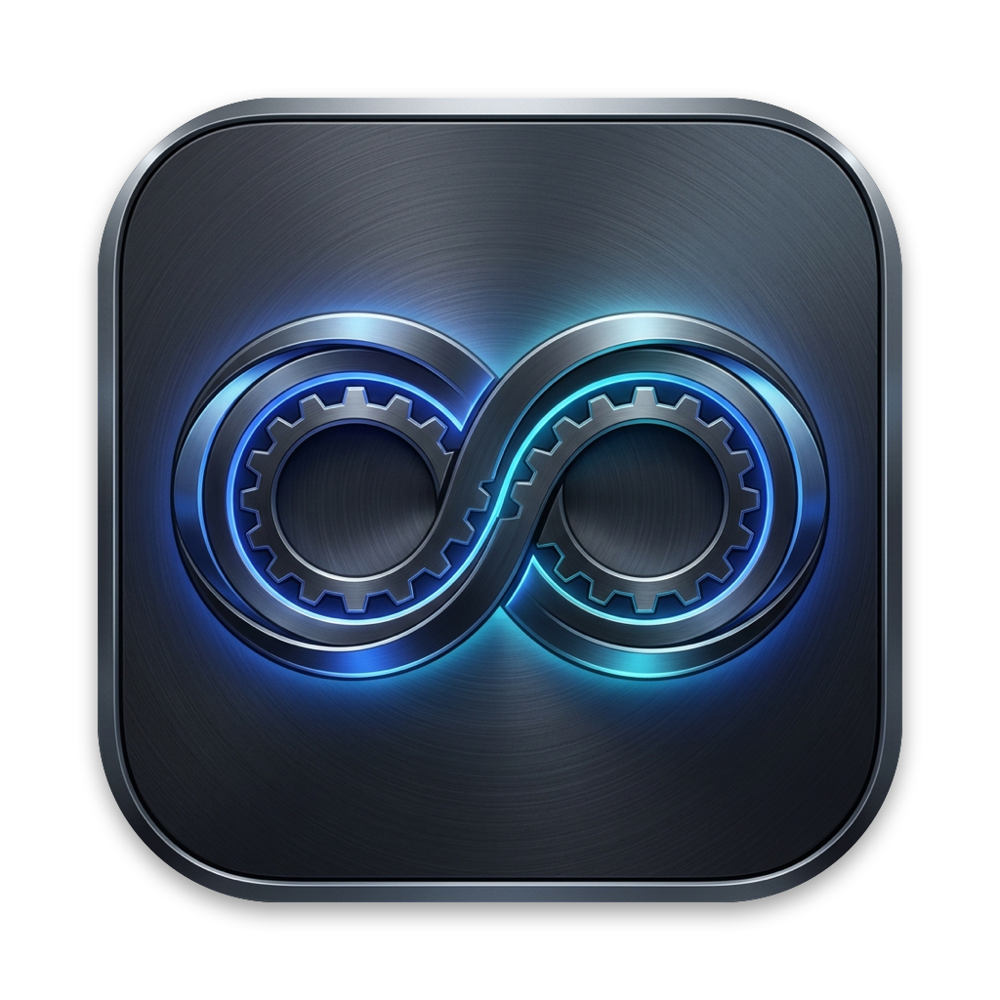
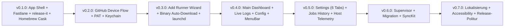

# OctoRunner — Concept & Step-by-Step Implementation Plan

**OctoRunner** (`OctoRunner.app`, Bundle-ID: `io.octorunner.macos`) ist eine native macOS Desktop-Applikation (macOS 15.0+ Sequoia, Apple Silicon / Universal 2, Swift 6.0 Strict Concurrency), mit der lokale **GitHub Actions Self-Hosted Runner** (insbesondere für iOS/macOS/Xcode-Builds) über `launchd` verwaltet, überwacht und skaliert werden.

## 1. Kernprinzipien & Leitlinien

- **Modernster Tech-Stack:** Swift 6.0+ (`Complete` Strict Concurrency), SwiftUI 6 (`@Observable`, `NavigationSplitView`, `MenuBarExtra`, `Settings`), SwiftData (`@Model`), Apple Keychain (Data Protection Keychain + Touch ID / `SecAccessControl`) & `ServiceManagement` (`SMAppService` / `launchd` User LaunchAgents).
- **Strikte Modularisierung:** Ein lokales Multi-Target Swift Package (`Packages/OctoRunnerKit`) trennt Datenmodelle, Security/Keychain, GitHub REST/OAuth API, Runner-Engine (`launchd` & Binary-Management), Hardware-Telemetrie und UI-Komponenten sauber voneinander.
- **Iteratives Release-Driven Development:** Jede Ausbaustufe (`v0.1.0`, `v0.2.0`, `v0.3.0`, ...) liefert ein **vollständig ausführbares, signiertes und über Homebrew Cask installierbares Release**, gesteuert über `release-it` + `Fastlane` (`match` & `notarytool`).
- **Integrierte Agent Skills (`.agents/skills/`):**
  - [`swiftui-pro`](../.agents/skills/swiftui-pro/SKILL.md) — Moderne SwiftUI APIs, HIG-Konformität, Accessibility & Performance
  - [`swift-security-expert`](../.agents/skills/swift-security-expert/SKILL.md) — Sichere Keychain-Speicherung (`SecItem`, Biometrie, Token-Lifecycle, Zero Secrets in `UserDefaults`)
  - [`swiftdata-pro`](../.agents/skills/swiftdata-pro/SKILL.md) — `@Model` Schema-Design, `@Relationship` Delete-Rules, sichere `#Predicate`-Abfragen & Indexing
  - [`swift-concurrency-pro`](../.agents/skills/swift-concurrency-pro/SKILL.md) — Actor-Isolation, Reentrancy-Schutz, Structured Concurrency (`TaskGroup`), `AsyncStream` & Cancellation

---

## 2. Dokumentations-Struktur (`docs/`)

Das Gesamtkonzept ist nach Architektur, Infrastruktur und den einzelnen Release-Meilensteinen (aufgeteilt nach Dialogen/Screens) gegliedert:

| Dokument | Fokus & Inhalt | Ziel-Release |
| :--- | :--- | :---: |
| **[01-architecture-and-modules.md](./01-architecture-and-modules.md)** | System-Architektur, Swift 6 Module (`OctoRunnerKit`), SwiftData Schema, Concurrency-Design & Localization (`DE`/`EN`) | Fundament |
| **[02-design-system-and-hig.md](./02-design-system-and-hig.md)** | macOS HIG Design System, Farben (Dark/Light + ANSI Terminal), Typografie & Komponenten-Spezifikation | Fundament |
| **[03-step-01-infrastructure-homebrew-release.md](./03-step-01-infrastructure-homebrew-release.md)** | **Step 1:** XcodeGen Setup, Fastlane (`match` Developer ID + Notarization), `release-it` Automation, GitHub Releases & Homebrew Tap (`homebrew-octorunner`) | **`v0.1.0`** |
| **[04-step-02-github-auth-device-flow.md](./04-step-02-github-auth-device-flow.md)** | **Step 2:** Einmaliges GitHub OAuth App Setup (Client ID ohne Secret), OAuth Device Flow (4 States) + PAT Fallback + Keychain (`swift-security-expert`) | **`v0.2.0`** |
| **[05-step-03-runner-wizard-and-engine.md](./05-step-03-runner-wizard-and-engine.md)** | **Step 3:** Add Runner Setup Wizard (Dialog 3), Auto-Download & Caching der GitHub Runner Binary (`osx-arm64`), `config.sh` & `launchd` Agent Registrierung | **`v0.3.0`** |
| **[06-step-04-dashboard-detail-and-menubar.md](./06-step-04-dashboard-detail-and-menubar.md)** | **Step 4:** Main Dashboard (Dialog 2), Advanced Runner Config & Labels (Dialog 4), Live ANSI Log Stream (Dialog 5) & macOS MenuBar Popover (Dialog 6) | **`v0.4.0`** |
| **[07-step-05-settings-telemetry-and-jobs.md](./07-step-05-settings-telemetry-and-jobs.md)** | **Step 5:** Settings Suite (Dialoge 7a–7e: General, launchd, Storage/Pruning, Auth, Notifications), Jobs Queue (Dialog 8) & Apple Silicon Telemetry (Dialog 9) | **`v0.5.0`** |
| **[08-sync-kit-and-local-runner-import.md](./08-sync-kit-and-local-runner-import.md)** | **`SyncKit`:** Discovery verwalteter Runner, bewusster Import externer Ordner, Live-PID-Erkennung und GitHub-Abgleich | **`v0.2.4` / `v0.3.0`** |
| **[09-pipeline-privacy-and-test-audit.md](./09-pipeline-privacy-and-test-audit.md)** | Pipeline-Prüfung, bedarfsgesteuerter Ordnerzugriff, minimale GitHub-Rechte und offene Testlücken | **`v0.4.4`** |
| **[10-development-and-acceptance.md](./10-development-and-acceptance.md)** | Entwicklungsstand aus Xcode abnehmen; Release-ZIP ohne Homebrew installieren | Abnahme |
| **[11-runner-status-and-notifications.md](./11-runner-status-and-notifications.md)** | Lokaler Menüleistenstatus, bedarfsgesteuerte macOS-Mitteilungen und Abnahmeschritte | In Arbeit für **`v0.5.0`** |
| **[12-jobs-history-and-metrics.md](./12-jobs-history-and-metrics.md)** | Jobs-API, Persistenzmigration und Definition der Kennzahlen | In Arbeit für **`v0.5.0`** |

---

## 3. Release-Roadmap (Immer ausführbar & testbar)

Nach v0.7.0 endet der freigegebene Versionsplan. v1.0.0 erfordert eine ausdrückliche Absprache.

### Wie wir vorgehen (Workflow pro Meilenstein):
1. **Umsetzung nach Plan-Dokument** (z.B. Start mit Step 1: `03-step-01-infrastructure-homebrew-release.md`).
2. **Code-Review gegen die 4 Agent Skills** (`swiftui-pro`, `swift-security-expert`, `swiftdata-pro`, `swift-concurrency-pro`).
3. **Lokaler Build, Tests und interaktive Abnahme** des Branches [direkt aus Xcode](./10-development-and-acceptance.md), ohne Homebrew-Installation der App.
4. **PR-CI abwarten, PR mergen und main-CI abwarten.**
5. **Release & Bereitstellung** via `npm run release`: `release-it` erstellt Versionscommit und Tag; der Tag startet den GitHub-Workflow für Build, Signierung, Notarisierung, GitHub Release und Homebrew-Tap. Den vollständigen Release-Lauf abwarten und anschließend Homebrew-Upgrade und Gatekeeper prüfen. Das signierte ZIP kann auch ohne Homebrew installiert werden.
