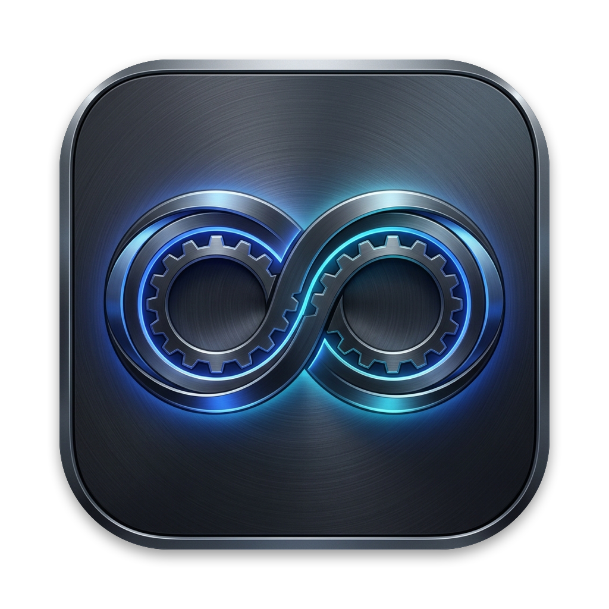
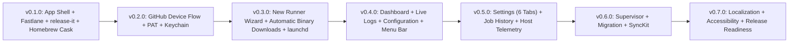

# OctoRunner Architecture and Implementation Plan

**OctoRunner** (`OctoRunner.app`, bundle ID `io.octorunner.macos`) is a native macOS app for managing, monitoring, and scaling local **GitHub Actions self-hosted runners** with `launchd`, especially for iOS, macOS, and Xcode builds. The design targets macOS 15 Sequoia or later, Apple Silicon and Universal 2 builds, and Swift 6 strict concurrency.

## 1. Design Principles

- **Native stack**. Swift 6.0+ with complete strict concurrency, SwiftUI 6 (`@Observable`, `NavigationSplitView`, `MenuBarExtra`, and `Settings`), SwiftData (`@Model`), Apple Keychain (Data Protection Keychain, Touch ID, and `SecAccessControl`), and ServiceManagement (`SMAppService` and per-user `launchd` LaunchAgents).
- **Modular design**. The local multi-target Swift package `Packages/OctoRunnerKit` separates data models, security and Keychain, GitHub REST and OAuth, the runner engine (launchd and binary management), host telemetry, and UI.
- **Release milestones**. Each milestone (`v0.1.0`, `v0.2.0`, `v0.3.0`, and so on) targets a runnable, signed release installable through Homebrew Cask. The release design uses `release-it`, Fastlane Match, and Apple's `notarytool`.
- **Repository agent skills** under `.agents/skills/`.
  - Modern SwiftUI APIs, macOS Human Interface Guidelines, accessibility, and performance. [swiftui-pro](../.agents/skills/swiftui-pro/SKILL.md)
  - Keychain storage (`SecItem`, biometrics, token lifecycle, and keeping secrets out of `UserDefaults`). [swift-security-expert](../.agents/skills/swift-security-expert/SKILL.md)
  - `@Model` schema design, `@Relationship` delete rules, safe `#Predicate` queries, and indexing. [swiftdata-pro](../.agents/skills/swiftdata-pro/SKILL.md)
  - Actor isolation, reentrancy protection, structured concurrency (`TaskGroup`), `AsyncStream`, and cancellation. [swift-concurrency-pro](../.agents/skills/swift-concurrency-pro/SKILL.md)

---

## 2. Documentation Index

The documents cover architecture, infrastructure, and the features and screens planned for each milestone.

| Document | Focus | Milestone |
| :--- | :--- | :---: |
| **[01-architecture-and-modules.md](./01-architecture-and-modules.md)** | System architecture, Swift 6 modules (`OctoRunnerKit`), SwiftData schema, concurrency design, and German and English localization | Foundation |
| **[02-design-system-and-hig.md](./02-design-system-and-hig.md)** | macOS design system, Light and Dark palettes, ANSI terminal colors, typography, and components | Foundation |
| **[03-step-01-infrastructure-homebrew-release.md](./03-step-01-infrastructure-homebrew-release.md)** | Step 1 plan for XcodeGen, Developer ID signing with Fastlane Match, notarization, `release-it`, GitHub Releases, and the `homebrew-octorunner` tap | **`v0.1.0`** |
| **[04-step-02-github-auth-device-flow.md](./04-step-02-github-auth-device-flow.md)** | Step 2 plan for GitHub OAuth app setup with a client ID and no client secret, four-state device flow, PAT fallback, and Keychain | **`v0.2.0`** |
| **[05-step-03-runner-wizard-and-engine.md](./05-step-03-runner-wizard-and-engine.md)** | Step 3 plan for the New Runner wizard (screen 3), automatic runner binary downloads and caching (`osx-arm64`), `config.sh`, and launchd registration | **`v0.3.0`** |
| **[06-step-04-dashboard-detail-and-menubar.md](./06-step-04-dashboard-detail-and-menubar.md)** | Step 4 plan for the dashboard (screen 2), runner configuration and labels (screen 4), live ANSI logs (screen 5), and menu bar popover (screen 6) | **`v0.4.0`** |
| **[07-step-05-settings-telemetry-and-jobs.md](./07-step-05-settings-telemetry-and-jobs.md)** | Step 5 plan for Settings (screens 7a–7e for General, launchd, storage and pruning, authentication, and notifications), job queue (screen 8), and Apple Silicon telemetry (screen 9) | **`v0.5.0`** |
| **[08-sync-kit-and-local-runner-import.md](./08-sync-kit-and-local-runner-import.md)** | SyncKit discovery of managed runners, explicit import from external folders, live PID detection, and GitHub reconciliation | **`v0.2.4` / `v0.3.0`** |
| **[09-pipeline-privacy-and-test-audit.md](./09-pipeline-privacy-and-test-audit.md)** | Pipeline review, on-demand folder access, minimum GitHub permissions, and test coverage gaps | **`v0.4.4`** |
| **[10-development-and-acceptance.md](./10-development-and-acceptance.md)** | Verify development builds in Xcode and install the release ZIP without Homebrew | Acceptance |
| **[11-runner-status-and-notifications.md](./11-runner-status-and-notifications.md)** | Local menu bar status, opt-in macOS notifications, and acceptance steps | **`v0.5.0`** development |
| **[12-jobs-history-and-metrics.md](./12-jobs-history-and-metrics.md)** | Jobs API, persistence migration, and metrics definitions | **`v0.5.0`** development |
| **[13-accounts-and-credentials.md](./13-accounts-and-credentials.md)** | Account identity, credential lifecycle, cancellation, and failure cases | **`v0.5.0`** development |
| **[14-runner-archive-integrity.md](./14-runner-archive-integrity.md)** | Required SHA-256 verification and public release digests without additional token permissions | **`v0.5.0`** development |
| **[15-cache-and-storage.md](./15-cache-and-storage.md)** | Managed runner storage analysis, safe cleanup, and automatic policies | **`v0.5.0`** development |
| **[16-audit-log.md](./16-audit-log.md)** | Local event history, filters, details, and JSON export | **`v0.5.0`** development |
| **[17-host-telemetry.md](./17-host-telemetry.md)** | Host measurement cards, device I/O, and per-account API budgets | **`v0.5.0`** development |
| **[18-remaining-delivery-plan.md](./18-remaining-delivery-plan.md)** | Verified progress and remaining plans, with runner concurrency enforcement starting in v0.6 | **v0.5–v0.7** |

---

## 3. Release Roadmap

Each milestone targets a runnable and testable release. The approved roadmap ends at v0.7.0. Starting v1.0.0 requires explicit agreement.

### Milestone Workflow

1. Implement the milestone using its plan, starting with `03-step-01-infrastructure-homebrew-release.md`.
2. Review the code using the four repository agent skills.
3. Build, test, and verify the branch interactively in Xcode without installing the app through Homebrew. [Development and acceptance guide](./10-development-and-acceptance.md)
4. Wait for PR CI to pass, merge the pull request, and wait for main CI to pass.
5. Run `npm run release`. `release-it` creates the version commit and tag. The tag triggers the GitHub build, signing, notarization, GitHub Release, and Homebrew tap update. After the workflow completes, verify the Homebrew upgrade and Gatekeeper approval. The signed ZIP also supports direct installation.

- [GitHub pull request links and Actions details added to v0.5](superpowers/plans/2026-11-19-workflow-github-details.md)
